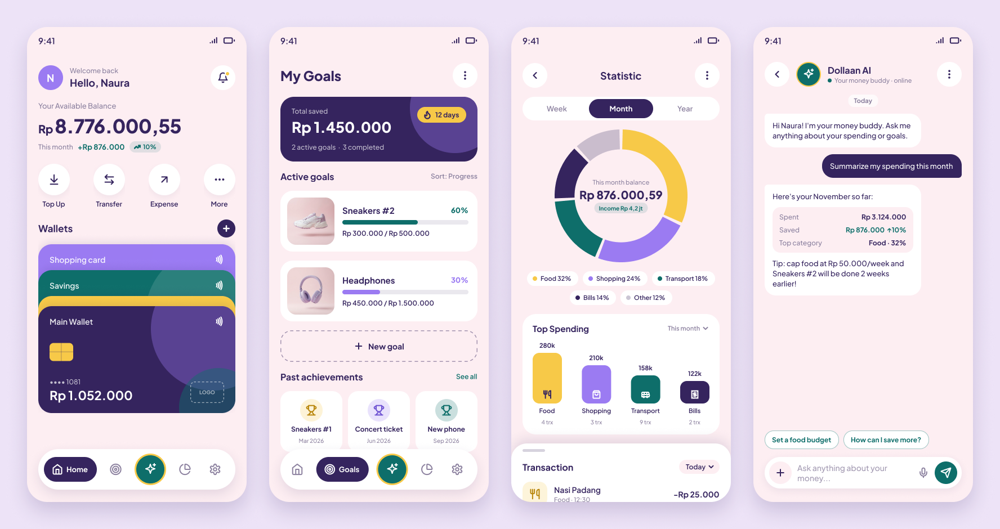
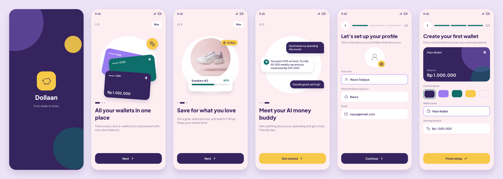
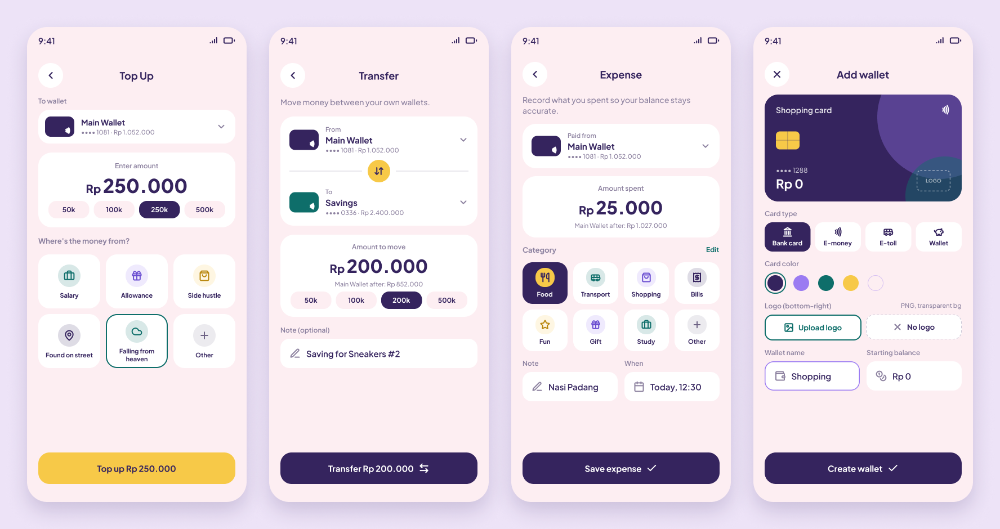
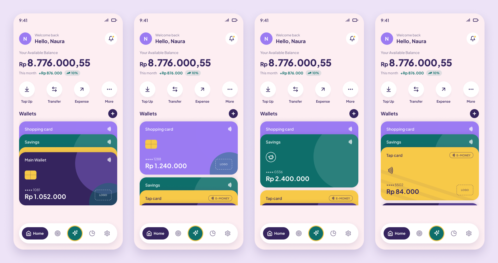
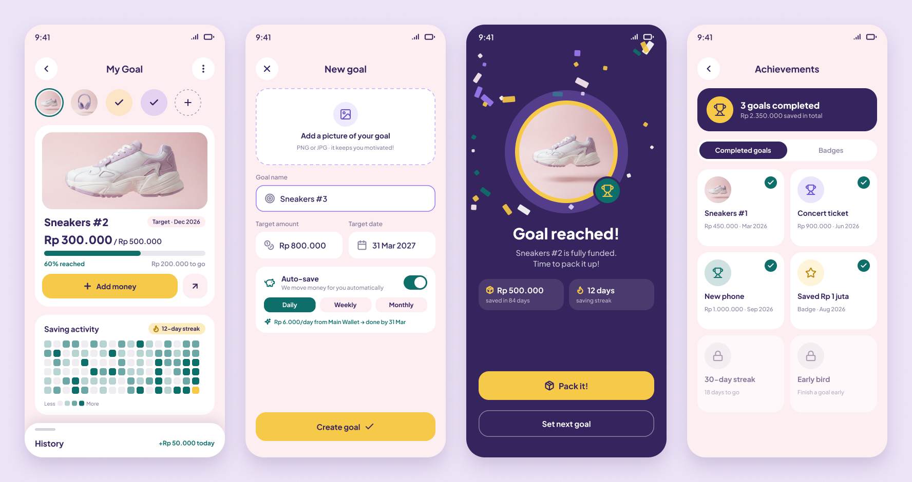
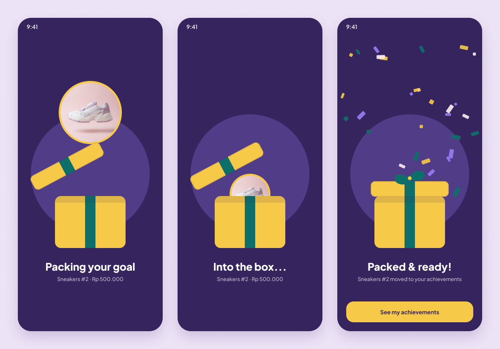
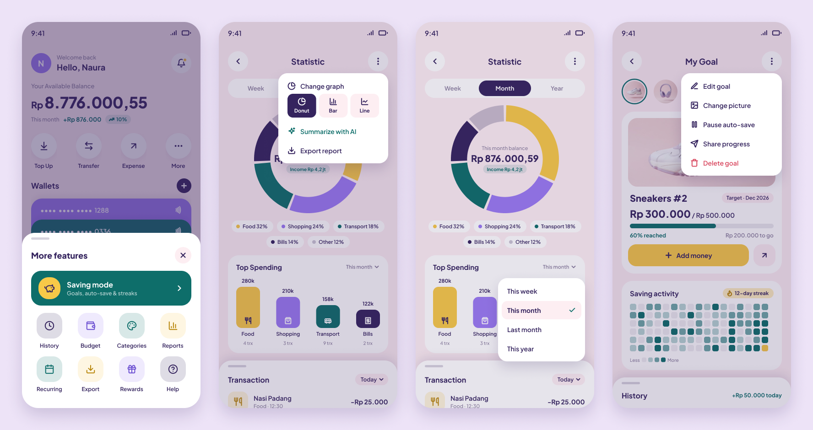
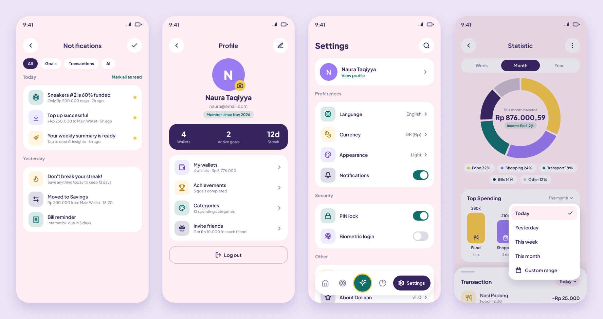

<div align="center">

# 🐷 Dollaan

**From dollar to dolan.**
Aplikasi pencatat keuangan pribadi untuk mahasiswa dan *first-jobber*: semua dompet dalam satu layar, menabung jadi seru.


-3DDC84?logo=android&logoColor=white)




</div>

> *Dolan* dalam bahasa Jawa berarti **main / jalan-jalan**. Dollaan membantu uangmu "dolan" ke tempat yang tepat: tercatat rapi, ditabung untuk barang impian, dan dirayakan saat target tercapai.

---

## Daftar isi

- [Tentang aplikasi](#tentang-aplikasi)
- [Fitur utama](#fitur-utama)
- [Tampilan](#tampilan)
- [Tech stack](#tech-stack)
- [Instalasi cepat](#instalasi-cepat)
- [Struktur project](#struktur-project)
- [Dokumentasi lengkap](#dokumentasi-lengkap)
- [Roadmap](#roadmap)
- [Lisensi & kredit](#lisensi--kredit)

---

## Tentang aplikasi

Banyak mahasiswa punya uang yang tersebar di rekening bank, e-wallet, kartu e-money, dan uang tunai. Akibatnya mereka tidak tahu total uangnya, lupa mencatat pengeluaran kecil, dan target menabung sering gagal.

**Dollaan** adalah aplikasi Android untuk **mencatat** (bukan memindahkan uang sungguhan) semua dompet itu dalam satu tempat, lalu membuat kebiasaan menabung terasa seperti main game: goal bergambar, *streak*, *heatmap*, *achievement*, dan animasi **"Pack it!"** saat barang impian sudah terkumpul uangnya.

| | |
| --- | --- |
| **Target pengguna** | Mahasiswa & *first-jobber* (18–27 tahun) yang punya banyak dompet |
| **Jenis aplikasi** | Personal finance tracker (pencatat), bukan dompet digital |
| **Distribusi** | File APK yang dipasang langsung (tanpa Play Store) |
| **Dikembangkan oleh** | 1 orang, fullstack |

## Fitur utama

| Fitur | Keterangan |
| --- | --- |
| 💳 **Multi-wallet** | Tambah wallet dengan 4 template kartu (Bank card, E-money, E-toll, Wallet), pilih warna, dan pasang logo sendiri di pojok kanan bawah |
| 🃏 **Tumpukan kartu interaktif** | Tap kartu di belakang → kartu terbuka penuh dengan animasi; tekan lama untuk menjadikannya kartu utama atau menghapus |
| ⬇️ **Top Up** | Catat pemasukan beserta sumbernya: *Salary*, *Allowance*, *Side hustle*, *Found on street*, *Falling from heaven* |
| ⇄ **Transfer** | Pindahkan dana antar wallet milik sendiri |
| ↗️ **Expense** | Catat pengeluaran per kategori (Food, Transport, Shopping, Bills, Fun, Gift, Study) |
| 📊 **Statistic** | Donut chart atau bar chart per kategori, *Top Spending*, filter periode (minggu/bulan/tahun), riwayat transaksi yang bisa dihapus dengan geser |
| 🎯 **Saving goals** | Goal dengan foto barang, target, tanggal, rekomendasi tabungan per hari, progress bar |
| 🔥 **Gamifikasi** | *Streak* menabung harian, *heatmap* aktivitas ala GitHub, *badge* & *achievement* |
| 📦 **Pack it!** | Animasi barang masuk kotak + confetti saat goal tercapai |
| 💬 **Chatbot** | Catat transaksi lewat kalimat biasa (`beli kopi 20rb`, `pindahin 200rb ke savings`) dan minta `rekap bulan ini` — tanpa API AI berbayar |
| 🔔 **Notifikasi in-app** | Goal hampir tercapai, pengingat streak, peringatan budget bulanan |
| 👤 **Onboarding & setup** | Onboarding 3 slide, setup profil → preferensi → wallet pertama |

## Tampilan

> Gambar di bawah diambil dari desain hi-fi di Figma. Tampilan aplikasi yang sudah berjalan bisa sedikit berbeda — lihat [proses desain](docs/01-design-process.md).

**Onboarding & setup awal**


**Mencatat uang: Top Up, Transfer, Expense, Add Wallet**


**Tumpukan kartu: tap kartu untuk membukanya**


**Saving goals sampai "Pack it!"**



**Menu, dropdown, dan layar lainnya**



## Tech stack

| Bagian | Teknologi |
| --- | --- |
| Aplikasi mobile | **Flutter** (Dart), Material 3, font Plus Jakarta Sans |
| Backend | **Supabase**: PostgreSQL, Auth (email), Storage, Row Level Security |
| State management | `ChangeNotifier` + `ListenableBuilder` bawaan Flutter |
| Chatbot | Rule-based di Dart (kata kunci + regex), berjalan di perangkat |
| Grafik & animasi | `CustomPainter` (donut, confetti), `AnimatedPositioned`, `AnimationController` |
| Desain | **Figma** (mockup hi-fi, prototype, komponen kartu, business docs) |

## Instalasi cepat

> Panduan lengkap untuk Windows, termasuk *troubleshooting*, ada di **[docs/06-setup-guide.md](docs/06-setup-guide.md)**.

**Prasyarat:** Flutter 3.27+, Android SDK (via Android Studio), akun [Supabase](https://supabase.com) gratis.

```bash
# 1. Clone
git clone https://github.com/Takia777/dollaan-finance-tracker.git
cd dollaan

# 2. Hanya jika folder android/ belum ada: buat folder platform
flutter create --org com.dollaan --project-name dollaan --platforms android,web .
```

3. **Siapkan Supabase:** buat project (region Singapore) → buka **SQL Editor** → jalankan [`supabase/schema.sql`](supabase/schema.sql). Untuk uji coba, matikan **Confirm email** di *Authentication → Sign In / Providers*.
4. **Isi konfigurasi** di [`lib/config.dart`](lib/config.dart) dengan **Project URL** dan **publishable/anon key** (Settings → API Keys). Atau kirim lewat `--dart-define` tanpa mengubah file:
   ```bash
   flutter run --dart-define=SUPABASE_URL=https://xxxx.supabase.co --dart-define=SUPABASE_ANON_KEY=sb_publishable_xxx
   ```
5. Tambahkan izin internet di `android/app/src/main/AndroidManifest.xml` (di atas `<application`):
   ```xml
   <uses-permission android:name="android.permission.INTERNET"/>
   ```
6. Jalankan dan build:
   ```bash
   flutter pub get
   flutter test                 # unit test chatbot & format Rupiah
   flutter run                  # ke HP/tablet/emulator, atau: flutter run -d chrome
   flutter build apk --release  # hasil: build/app/outputs/flutter-apk/app-release.apk
   ```

> 🔐 **Keamanan:** *publishable/anon key* memang boleh berada di aplikasi karena data dilindungi Row Level Security. **Jangan pernah** meng-commit *secret / service_role key*.

## Struktur project

```
dollaan/
├─ lib/
│  ├─ main.dart            # inisialisasi Supabase & MaterialApp
│  ├─ config.dart          # URL & key Supabase
│  ├─ theme.dart           # palet warna, font, helper gaya teks
│  ├─ models.dart          # Profile, Wallet, Txn, Goal, ChatMsg
│  ├─ categories.dart      # kategori pengeluaran & sumber pemasukan
│  ├─ data/repo.dart       # semua akses Supabase (auth, CRUD, storage)
│  ├─ state/app_state.dart # sumber data tunggal + perhitungan saldo/statistik/streak
│  ├─ chatbot/chatbot.dart # parser chatbot rule-based
│  ├─ ui/                  # widget umum, kartu wallet, painter grafik
│  └─ screens/             # 20+ layar aplikasi
├─ supabase/schema.sql     # tabel, trigger, RLS, storage bucket
├─ test/                   # unit test
└─ docs/                   # dokumentasi teknis + gambar
```

## Dokumentasi lengkap

Dokumentasi teknis yang membahas seluruh isi project secara mendalam ada di folder **[`docs/`](docs/README.md)**:

| # | Dokumen | Isi |
| --- | --- | --- |
| 1 | [Proses desain](docs/01-design-process.md) | Dari sketsa tangan → mockup Figma → prototype → VPC, BMC, BPMN, use case, dan keputusan desain |
| 2 | [Arsitektur](docs/02-architecture.md) | Gambaran sistem, lapisan kode, alur data, navigasi, state management |
| 3 | [Database](docs/03-database.md) | ERD, penjelasan tiap tabel, Row Level Security, storage, cara menghitung saldo |
| 4 | [Bedah kode](docs/04-code-walkthrough.md) | Penjelasan file per file dengan potongan kode penting |
| 5 | [Chatbot](docs/05-chatbot.md) | Pipeline NLP sederhana: normalisasi, intent, regex nominal, slot filling, testing |
| 6 | [Panduan setup](docs/06-setup-guide.md) | Instalasi detail di Windows, Supabase, build & pasang APK, troubleshooting |
| 7 | [Kendala & pelajaran](docs/07-challenges-and-lessons.md) | Masalah nyata selama pengembangan dan cara mengatasinya, bug v1.0, rencana v2 |

## Roadmap

- [x] v1.0 — wallet, transaksi, statistik, saving goals, gamifikasi, chatbot rule-based, APK
- [ ] v1.1 — perbaikan bug uji coba ([daftar](docs/07-challenges-and-lessons.md#bug-yang-ditemukan-di-v10)), chatbot dengan memori draf, auto-save goal
- [ ] v1.2 — mode offline, PIN & biometrik, push notification terjadwal, terjemahan Bahasa Indonesia penuh
- [ ] Nanti — export laporan, budget per kategori, transaksi berulang, versi iOS

## Lisensi & kredit

Dirilis di bawah lisensi [MIT](LICENSE).

- Desain, pengembangan, dan pengujian: **Naura Taqiyya Mazi** — Teknik Informatika, Institut Teknologi Sepuluh Nopember (ITS).
- Mockup Figma, kode awal, dan dokumentasi disusun dengan bantuan asisten AI (Claude, Anthropic), lalu diuji dan disesuaikan sendiri.
- Ikon: Material Icons & Lucide · Font: Plus Jakarta Sans (Google Fonts).
- Logo bank/jaringan kartu **tidak** disertakan; pengguna mengunggah logo sendiri sesuai pedoman merek masing-masing.
