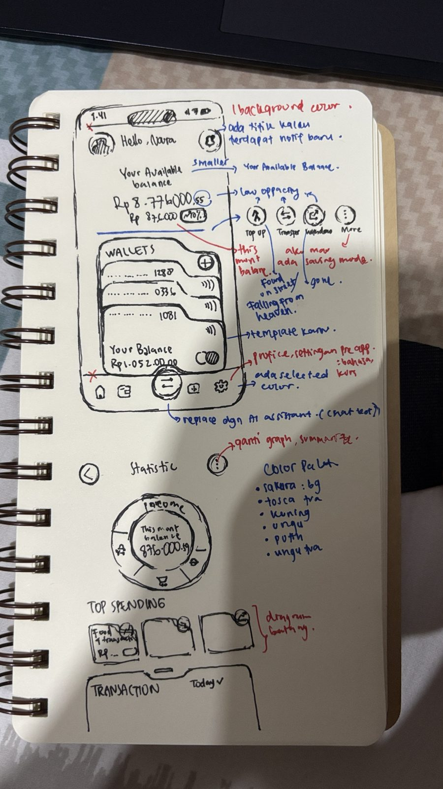
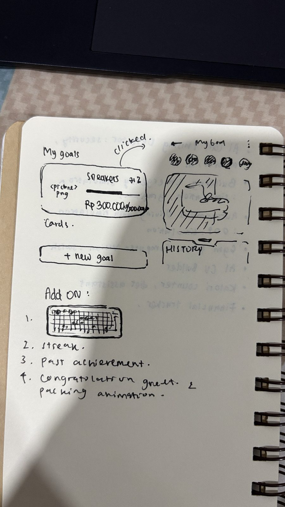
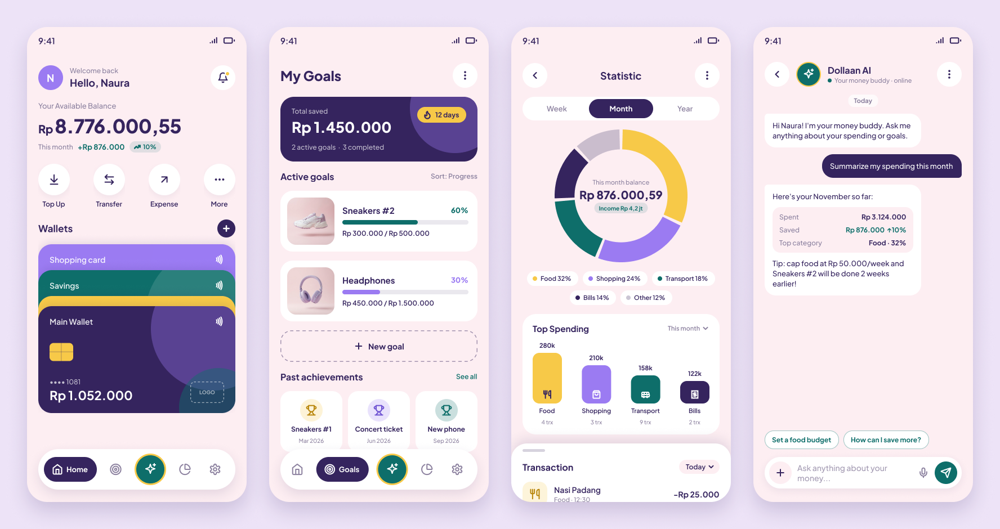
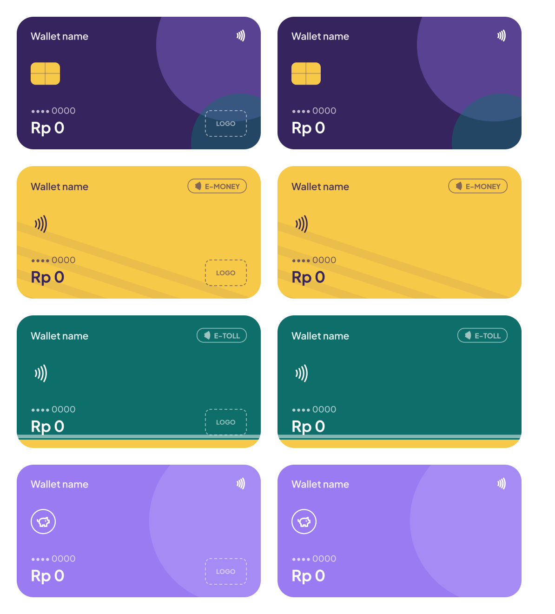
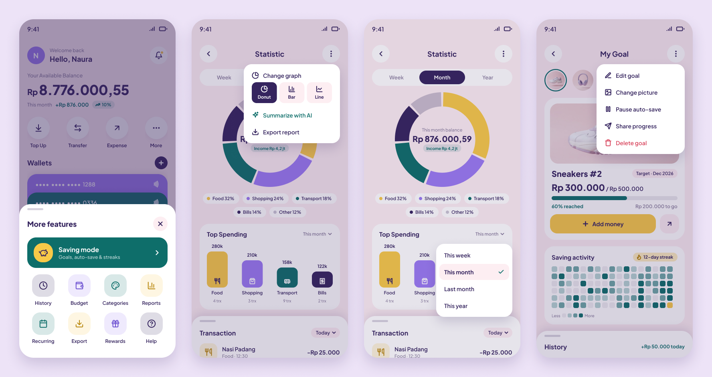
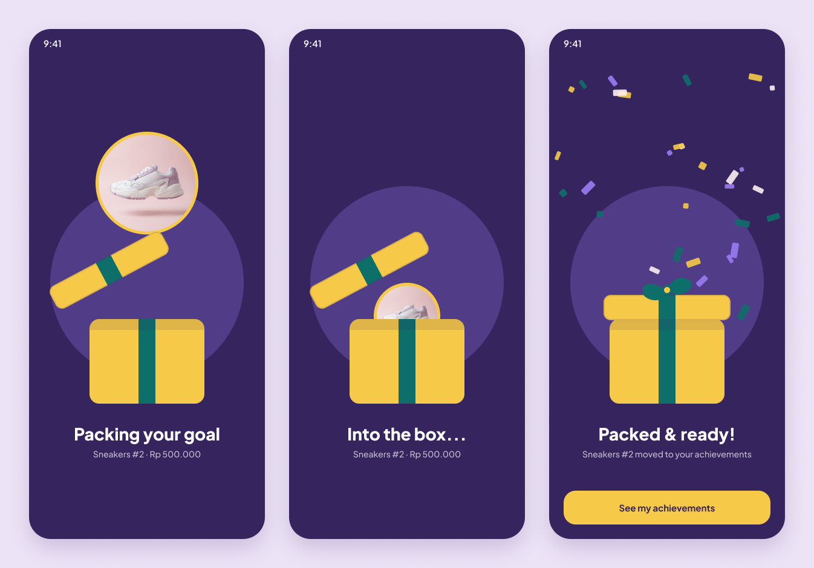
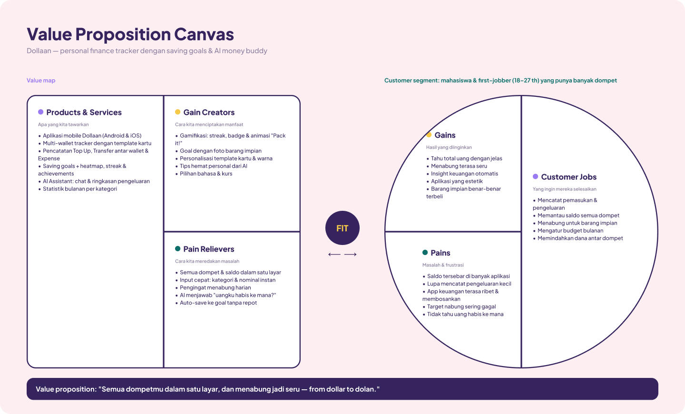
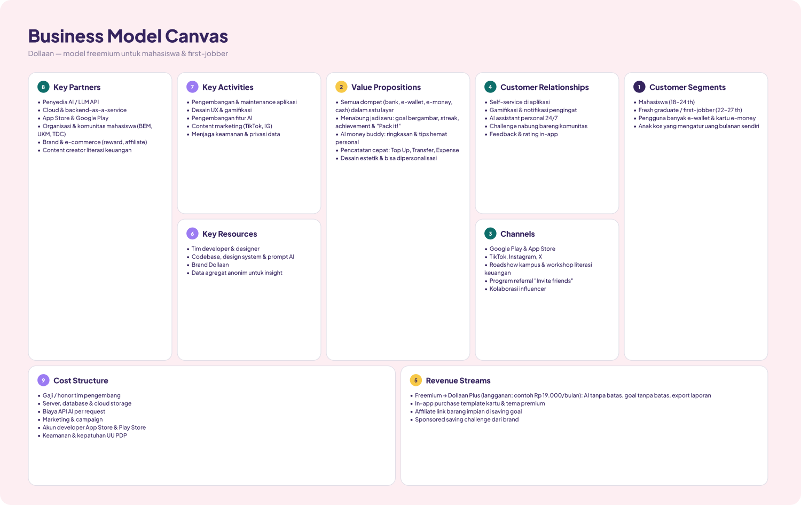
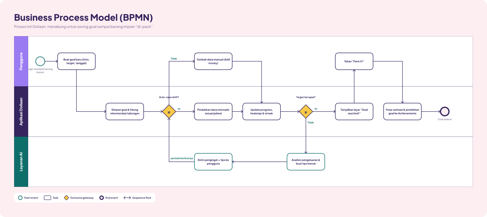
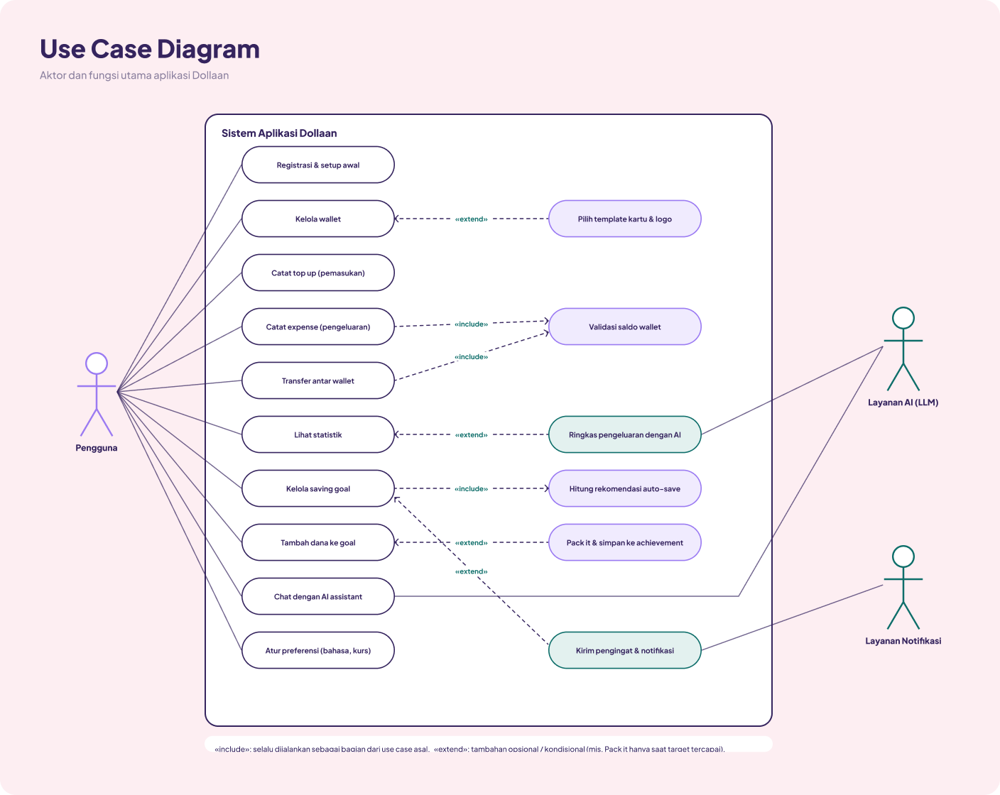

# 1. Proses Desain

Dokumen ini menceritakan perjalanan Dollaan dari ide sampai desain siap dikodekan: sketsa tangan, mockup hi-fi di Figma, prototype yang bisa diklik, dokumen bisnis, dan keputusan-keputusan desain yang berubah di tengah jalan.

## Daftar isi
- [1.1 Masalah yang ingin diselesaikan](#11-masalah-yang-ingin-diselesaikan)
- [1.2 Sketsa tangan (lo-fi)](#12-sketsa-tangan-lo-fi)
- [1.3 Dari sketsa ke mockup hi-fi](#13-dari-sketsa-ke-mockup-hi-fi)
- [1.4 Sistem desain](#14-sistem-desain)
- [1.5 Melengkapi layar & interaksi](#15-melengkapi-layar--interaksi)
- [1.6 Prototype di Figma](#16-prototype-di-figma)
- [1.7 Keputusan desain yang berubah](#17-keputusan-desain-yang-berubah)
- [1.8 Dokumen bisnis](#18-dokumen-bisnis)
- [1.9 Dari desain ke kode](#19-dari-desain-ke-kode)

---

## 1.1 Masalah yang ingin diselesaikan

Mahasiswa sering punya uang di banyak tempat: rekening bank, e-wallet, kartu e-money/e-toll, dan uang tunai. Masalah yang muncul:

1. **Tidak tahu total uang** karena saldonya tersebar di banyak aplikasi.
2. **Lupa mencatat pengeluaran kecil**, sehingga "uang habis ke mana" tidak terjawab.
3. **Aplikasi keuangan terasa membosankan**, sehingga kebiasaan mencatat tidak bertahan.
4. **Target menabung sering gagal** karena tidak ada motivasi yang terlihat.

Dollaan menjawabnya dengan satu layar untuk semua dompet, pencatatan cepat (termasuk lewat chat), dan gamifikasi menabung.

## 1.2 Sketsa tangan (lo-fi)

Semua dimulai dari dua halaman buku catatan. Sketsa ini adalah wireframe **lo-fi**: fokus pada tata letak dan alur, belum pada warna atau detail visual.

| Home & Statistic | My Goals & add-on |
| --- | --- |
|  |  |

Catatan-catatan di sketsa (tinta biru/merah) yang kemudian menjadi keputusan desain:

| Catatan di sketsa | Diterjemahkan menjadi |
| --- | --- |
| "ada titik kalau terdapat notif baru" | Titik kuning di ikon lonceng (`CircleBtn(badge: true)`) |
| "smaller → Your Available Balance" | Label saldo dibuat kecil dan abu-abu |
| "low opacity" (pada `,55`) | Angka desimal saldo dibuat transparan (`BalanceText`) |
| "this month balance" + "10%" | Baris saldo bulan ini + badge pertumbuhan |
| "Top up → found on street, falling from heaven" | Sumber pemasukan yang jenaka di layar Top Up |
| "aku mau ada saving mode → goal" (dari **More**) | Kartu *Saving mode* di sheet More menuju tab Goals |
| "template kartu" | Komponen kartu dengan 4 tipe |
| "profile, settingan pre app: bahasa, kurs" | Layar Profile & Settings |
| "ada selected color" | Tab aktif di navbar berbentuk pil berwarna |
| "replace dgn AI assistant (chat text)" | Tombol tengah navbar → chatbot |
| "ganti graph, summarize" (menu ⋮ Statistic) | Menu ganti grafik & ringkas lewat chatbot |
| "diagram batang" (Top Spending) | Top Spending ditampilkan sebagai diagram batang |
| ✕ merah di garis pembatas | Tidak ada garis pembatas antar-bagian |
| Add on: heatmap, streak, past achievement, congratulation & packing animation | Heatmap aktivitas, streak, achievements, layar *Goal reached*, animasi *Pack it* |
| Palet: sakura, tosca tua, kuning, ungu, putih, ungu tua | Palet warna aplikasi |

## 1.3 Dari sketsa ke mockup hi-fi

Sketsa lalu dibangun ulang sebagai mockup **hi-fi** di Figma: warna, tipografi, ikon, foto, dan angka realistis. Ukuran frame **390 × 844** (ukuran layar HP modern).

Beberapa keputusan kecil saat menerjemahkan sketsa:

- **Saldo besar dengan "Rp" kecil dan desimal pudar** agar angka utama paling menonjol.
- **Kartu wallet ditumpuk** seperti dompet fisik; hanya kartu utama yang terlihat penuh, yang lain mengintip 46 px.
- **Navbar mengambang** (floating) dengan sudut membulat dan tombol chatbot berwarna tosca dengan cincin kuning di tengah.
- **Bottom sheet** untuk daftar transaksi di Statistic dan riwayat di Goal detail, sesuai bentuk "laci" di sketsa.

## 1.4 Sistem desain

### Palet warna

| Nama | Hex | Dipakai untuk |
| --- | --- | --- |
| Sakura | `#FDEEF2` | Latar belakang semua layar |
| Tosca tua | `#0E6E6A` | Aksen positif, progress, tombol chatbot |
| Kuning | `#F7C948` | Tombol utama (CTA), streak, chip kartu |
| Ungu | `#9B7BF2` | Aksen sekunder, avatar |
| Putih | `#FFFFFF` | Kartu konten |
| Ungu tua | `#35245E` | Teks utama, tombol gelap, kartu utama |
| Muted | `#8C819F` | Teks sekunder |

Di Figma, warna ini disimpan sebagai **color variables** (koleksi *Palette*), sehingga mengubah satu variabel mengubah semua layar. Di kode, warna yang sama ada di `lib/theme.dart` (`AppColors`).

### Tipografi & bentuk
- Font **Plus Jakarta Sans** (Regular–ExtraBold).
- Radius sudut: 16 (input), 20–24 (kartu), 28 (bottom sheet), lingkaran penuh untuk tombol ikon.
- Ikon garis (gaya Lucide di Figma, Material Rounded di Flutter).

### Komponen kartu wallet

Kartu dibuat sebagai **component set** dengan dua properti: `Type` (Bank card, E-money, E-toll, Wallet) dan `Logo` (On/Off). Nama wallet, nomor, dan saldo adalah *text property* yang bisa diganti.

Keputusan penting: **tidak menggambar ulang logo merek** (Mastercard, VISA, BCA, Mandiri, Flazz, dll). Sebagai gantinya ada **slot logo** di pojok kanan bawah yang diisi pengguna dengan logo resmi miliknya sendiri. Ini menghindari masalah hak merek dagang di repo publik.

## 1.5 Melengkapi layar & interaksi

Setelah layar inti, desain diperluas sampai mencakup seluruh perjalanan pengguna:

- **Onboarding & setup:** splash, 3 slide onboarding, setup profil → preferensi (bahasa, kurs, budget) → wallet pertama.
- **Fitur:** notifikasi, profil, Top Up, Transfer, Expense, Add Wallet, chatbot, settings, New Goal, Achievements.
- **State & overlay:** sheet *More*, menu ⋮ Statistic, dropdown Top Spending & Transaction, menu ⋮ My Goal.
- **Animasi:** 3 keyframe *Pack it* (kotak terbuka → barang masuk → kotak tertutup + pita + confetti).
- **Tumpukan kartu:** 3 state ketika kartu lain di-tap.

## 1.6 Prototype di Figma

Semua layar disambungkan menjadi prototype yang bisa diklik (±94 interaksi):

- **Dua titik mulai (flow):** *Onboarding* (mulai dari splash) dan *Main app* (mulai dari Home).
- **Transisi:** *Push* untuk masuk ke layar baru, *Dissolve* untuk tab & overlay, **Smart Animate** untuk animasi *Pack it* dan tumpukan kartu (layer dengan nama yang sama di dua frame akan dianimasikan otomatis).
- **Auto-advance:** splash pindah sendiri setelah 1,2 detik; frame *Pack it* berpindah otomatis tiap 0,5–0,7 detik.

Pelajaran: memberi **nama layer yang konsisten** (`btn:Top Up`, `nav:Goals`, `Item`, `Lid`) membuat penyambungan prototype bisa diotomatisasi dan Smart Animate bekerja dengan benar.

## 1.7 Keputusan desain yang berubah

Desain tidak lahir sekali jadi. Berikut perubahan penting beserta alasannya:

| Sebelum | Sesudah | Alasan |
| --- | --- | --- |
| Ikon **Wallet** di navbar | Tab **Goals** | Daftar wallet sudah tampil lengkap di Home; Goals adalah fitur pembeda sehingga layak punya tab sendiri |
| **Transfer** ke kontak (seperti e-wallet) | Pindah dana **antar wallet sendiri** | Dollaan adalah pencatat, bukan alat pembayaran |
| **Withdraw** (tarik dana ke bank) | **Expense** (catat pengeluaran) | "Withdraw" lazim dipahami sebagai tarik tunai; "Expense" langsung jelas |
| Nama sementara **Celengan** | **Dollaan** | Permainan kata *dollar* → *dolan* (main, bahasa Jawa) |
| Template kartu bermerek (BCA, Flazz, dll.) | Template generik + **slot logo** | Menghindari reproduksi logo/desain merek |
| AI assistant memakai **Claude API** | **Chatbot rule-based** buatan sendiri | API dibayar per token dan tidak termasuk langganan chat; fitur yang dibutuhkan cukup dengan aturan sederhana |
| Distribusi **Play Store** | **File APK** | Fokus uji coba pribadi dan teman; tanpa proses review store |
| Tim 4 orang, 16 minggu | **Solo developer**, 20 minggu | Sesuai kondisi nyata |

## 1.8 Dokumen bisnis

Sebagai bagian dari perancangan produk, dibuat empat artefak di Figma (halaman *Business Docs*).

> Catatan: dokumen ini dibuat **sebelum** keputusan beralih dari Claude API ke chatbot rule-based, sehingga beberapa bagian masih menyebut "AI / LLM". Konsepnya tetap sama — "asisten" yang membantu mencatat dan meringkas — hanya implementasinya yang berubah.

### Value Proposition Canvas
Menghubungkan *customer jobs, pains, gains* mahasiswa dengan produk Dollaan.

### Business Model Canvas
Model **freemium**: fitur dasar gratis, langganan opsional (contoh harga hanya ilustrasi), in-app purchase tema kartu, affiliate barang impian.

### Business Process Model (BPMN)
Proses inti: membuat goal → menabung (manual/otomatis) → cek target → *Goal reached* → *Pack it* → achievement. Tiga *swimlane*: Pengguna, Aplikasi, Layanan AI.

### Use Case Diagram
Aktor **Pengguna**, **Layanan AI**, **Layanan Notifikasi**, dengan relasi «include» (selalu dijalankan) dan «extend» (kondisional).

## 1.9 Dari desain ke kode

Setiap frame Figma dipetakan ke satu file Flutter:

| Frame Figma | File Flutter |
| --- | --- |
| 00 · Splash | `lib/screens/splash_screen.dart` |
| 00 · Onboarding 1–3 | `lib/screens/onboarding_screen.dart` |
| 00 · Setup 1–3 | `lib/screens/setup_screen.dart` |
| 01 · Home (+ state kartu terbuka) | `lib/screens/home_screen.dart` (`WalletStack`) |
| 02 · Statistic (+ menu & dropdown) | `lib/screens/statistic_screen.dart` |
| 03 · My Goals | `lib/screens/goals_screen.dart` |
| 04 · My Goal (detail) | `lib/screens/goal_detail_screen.dart` |
| 05 · Goal reached | `lib/screens/goal_reached_screen.dart` |
| 06 · Notifications | `lib/screens/notifications_screen.dart` |
| 07 · Profile | `lib/screens/profile_screen.dart` |
| 08 · Top Up & 10 · Expense | `lib/screens/transaction_screen.dart` |
| 09 · Transfer | `lib/screens/transfer_screen.dart` |
| 11 · Add Wallet | `lib/screens/add_wallet_screen.dart` |
| 12 · AI Assistant | `lib/screens/chat_screen.dart` |
| 13 · Settings | `lib/screens/settings_screen.dart` |
| 14 · More (sheet) | `lib/screens/more_sheet.dart` |
| 19 · New Goal | `lib/screens/new_goal_screen.dart` |
| 20 · Achievements | `lib/screens/achievements_screen.dart` |
| 21–23 · Pack it | `lib/screens/pack_screen.dart` |
| Komponen *Wallet card* | `lib/ui/wallet_card.dart` |

Lanjut ke **[2. Arsitektur →](02-architecture.md)**
