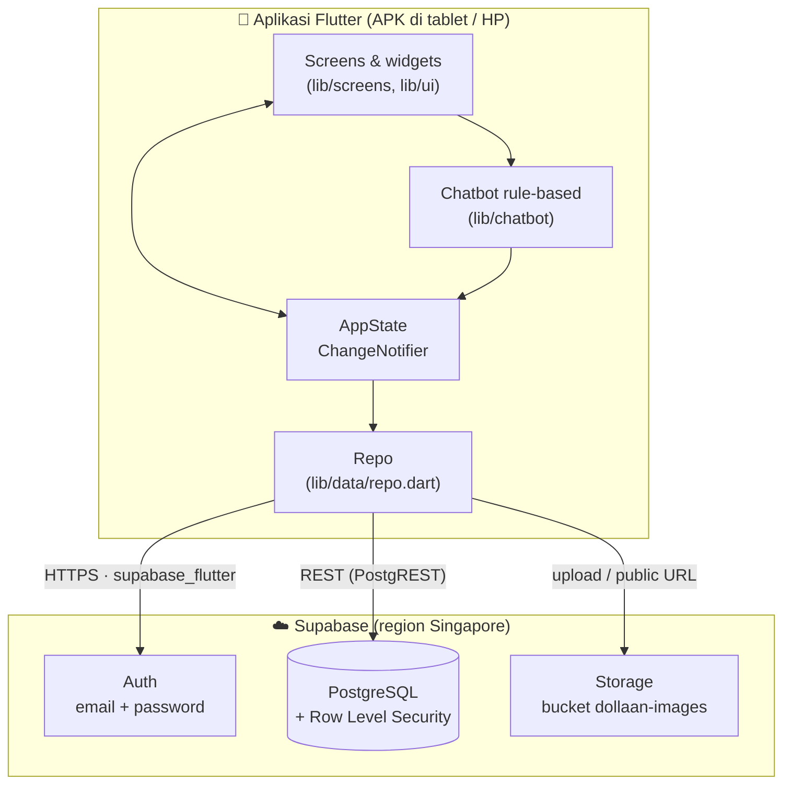
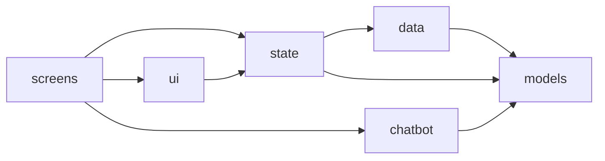
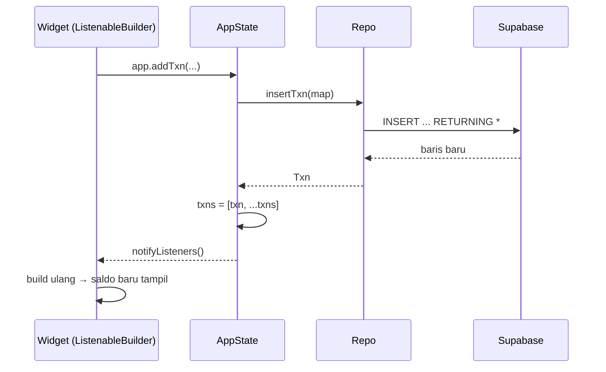
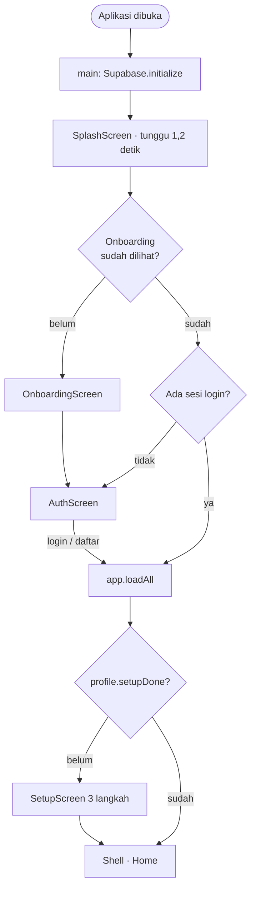
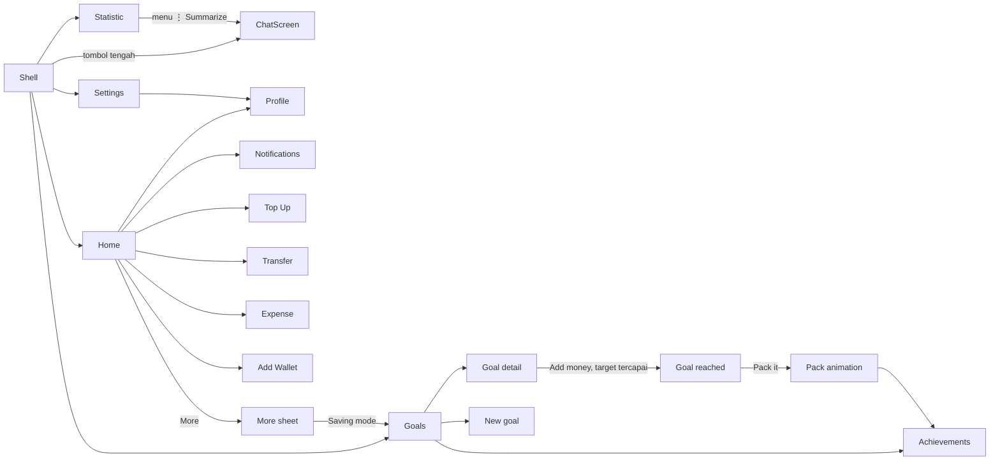
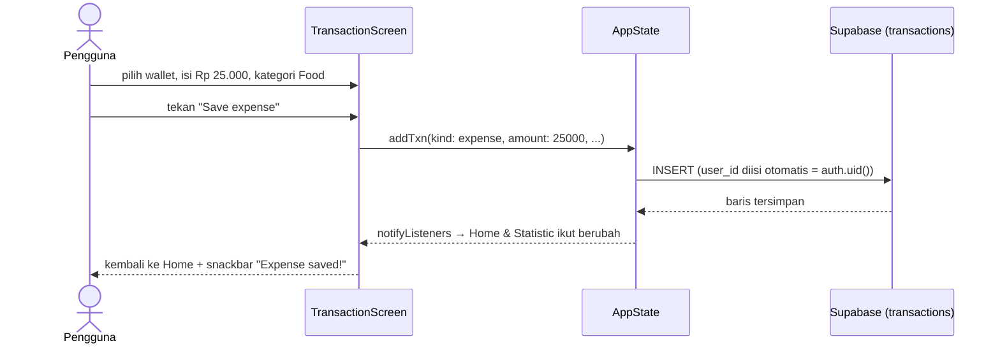
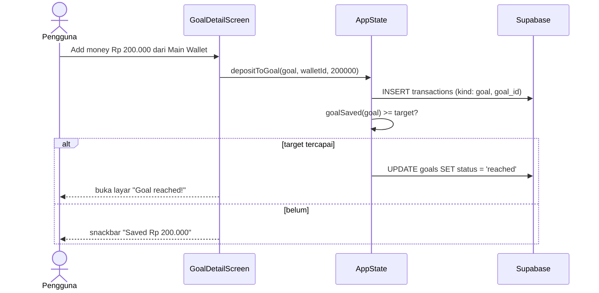

# 2. Arsitektur

Dokumen ini menjelaskan gambaran besar Dollaan: komponen sistem, lapisan kode, navigasi, dan bagaimana data mengalir dari layar ke database lalu kembali lagi.

## Daftar isi
- [2.1 Gambaran sistem](#21-gambaran-sistem)
- [2.2 Lapisan kode](#22-lapisan-kode)
- [2.3 State management](#23-state-management)
- [2.4 Alur saat aplikasi dibuka](#24-alur-saat-aplikasi-dibuka)
- [2.5 Peta navigasi](#25-peta-navigasi)
- [2.6 Contoh alur data](#26-contoh-alur-data)
- [2.7 Keputusan arsitektur & trade-off](#27-keputusan-arsitektur--trade-off)

---

## 2.1 Gambaran sistem



Poin pentingnya:

- **Tidak ada server buatan sendiri.** Supabase menyediakan database, login, dan penyimpanan file. Aplikasi berbicara langsung ke Supabase lewat library `supabase_flutter`.
- **Keamanan ada di database**, bukan di aplikasi. Setiap tabel punya aturan *Row Level Security* (RLS) sehingga pengguna hanya bisa membaca dan mengubah datanya sendiri — walaupun *publishable/anon key* tertanam di APK.
- **Chatbot berjalan di perangkat.** Tidak ada panggilan ke layanan AI, jadi tidak ada biaya per pesan.

## 2.2 Lapisan kode

```
lib/
├─ main.dart               ← titik masuk
├─ config.dart             ← konfigurasi (URL & key)
├─ theme.dart              ← palet warna, font, helper gaya
├─ models.dart             ← tipe data (Profile, Wallet, Txn, Goal, ChatMsg)
├─ categories.dart         ← data statis kategori
├─ utils/format.dart       ← format Rupiah & tanggal
├─ data/repo.dart          ← LAPISAN DATA: semua query Supabase
├─ state/app_state.dart    ← LAPISAN STATE/LOGIKA: data di memori + perhitungan
├─ chatbot/chatbot.dart    ← LOGIKA chatbot (murni Dart, mudah dites)
├─ ui/                     ← LAPISAN UI umum: widget, kartu, painter
└─ screens/                ← LAPISAN UI: satu file per layar
```

Aturan ketergantungan (dependency) dijaga searah:



- **Layar tidak pernah memanggil Supabase langsung.** Semua lewat `app` (AppState), yang memakai `Repo`.
- **`chatbot.dart` tidak bergantung pada Flutter.** Ia hanya memakai `models.dart`, sehingga bisa diuji dengan unit test biasa.
- **Perhitungan (saldo, statistik, streak) ada di AppState**, bukan di widget. Widget hanya menampilkan.

## 2.3 State management

Dollaan memakai pola paling sederhana yang disediakan Flutter: satu objek `ChangeNotifier` global.

```dart
// lib/state/app_state.dart
final app = AppState();

class AppState extends ChangeNotifier {
  Profile? profile;
  List<Wallet> wallets = [];
  List<Txn> txns = [];
  List<Goal> goals = [];
  ...
  Future<Txn> addTxn(...) async {
    final txn = await repo.insertTxn({...});   // 1. simpan ke Supabase
    txns = [txn, ...txns];                    // 2. perbarui data di memori
    notifyListeners();                        // 3. beri tahu semua layar
    return txn;
  }
}
```

Layar yang perlu ikut berubah membungkus tampilannya dengan `ListenableBuilder`:

```dart
ListenableBuilder(
  listenable: app,
  builder: (context, _) => BalanceText(app.totalBalance),
);
```



**Kenapa bukan Riverpod/Bloc?** Untuk developer solo dan ukuran aplikasi ini, `ChangeNotifier` cukup, tanpa dependensi tambahan dan tanpa konsep baru yang harus dipelajari dulu. Kelemahannya: semua layar yang mendengarkan `app` ikut di-build ulang saat apa pun berubah. Untuk skala Dollaan ini tidak terasa. Kalau aplikasi membesar, `AppState` bisa dipecah (misalnya `WalletStore`, `GoalStore`) atau dipindah ke Riverpod tanpa mengubah `Repo`.

## 2.4 Alur saat aplikasi dibuka



- Status "sudah onboarding" disimpan di perangkat dengan `shared_preferences`.
- Sesi login disimpan otomatis oleh `supabase_flutter`, jadi pengguna tidak perlu login ulang setiap membuka aplikasi.
- `setup_done` disimpan di tabel `profiles`, sehingga setup tidak muncul lagi di perangkat lain.

## 2.5 Peta navigasi



`Shell` memakai `IndexedStack` sehingga keempat tab tetap "hidup" saat berpindah (posisi scroll tidak hilang). Tab aktif disimpan di `app.tab` (`ValueNotifier<int>`), sehingga layar lain bisa berpindah tab — misalnya kartu *Saving mode* di sheet More menjalankan `app.tab.value = 1`.

## 2.6 Contoh alur data

### Mencatat pengeluaran lewat layar Expense



### Menabung ke goal sampai tercapai



### Mencatat lewat chatbot
Lihat diagram lengkap di [5. Chatbot](05-chatbot.md).

## 2.7 Keputusan arsitektur & trade-off

| Keputusan | Keuntungan | Kekurangan / risiko |
| --- | --- | --- |
| Supabase sebagai backend | Tanpa server sendiri, SQL penuh, paket gratis | Butuh internet; project gratis bisa di-*pause* jika lama tidak aktif |
| Saldo **dihitung** dari transaksi (tidak disimpan) | Saldo selalu konsisten dengan riwayat; hapus transaksi = saldo otomatis benar | Perhitungan di sisi aplikasi; untuk ribuan transaksi sebaiknya dipindah ke *view* SQL |
| Semua data dimuat sekali (`loadAll`) | Kode sederhana, layar cepat setelah dimuat | Tidak cocok untuk data sangat besar; perlu pagination nanti |
| Chatbot di perangkat | Gratis, cepat, bisa dites tanpa jaringan | Hanya memahami pola yang sudah ditulis |
| Notifikasi dihitung dari data (in-app) | Tidak perlu server push | Tidak muncul saat aplikasi tertutup |
| `ChangeNotifier` global | Mudah dipahami | Rebuild lebih luas dari perlu |

Lanjut ke **[3. Database →](03-database.md)**
