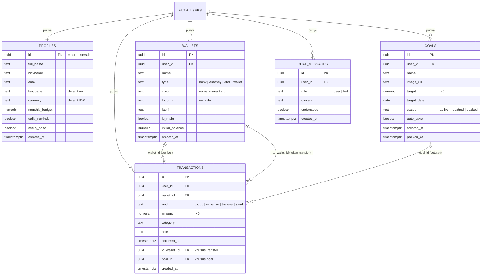
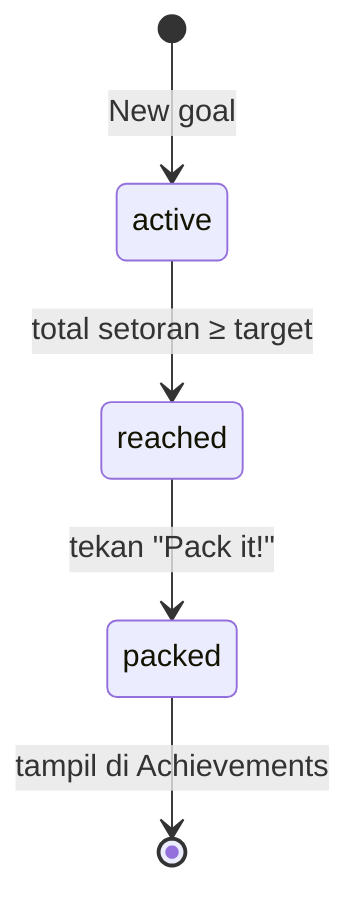

# 3. Database

Seluruh data Dollaan disimpan di **PostgreSQL milik Supabase**. Skemanya ada di satu file: [`supabase/schema.sql`](../supabase/schema.sql), yang dijalankan sekali di SQL Editor.

## Daftar isi
- [3.1 ERD](#31-erd)
- [3.2 Penjelasan tabel](#32-penjelasan-tabel)
- [3.3 Trigger profil otomatis](#33-trigger-profil-otomatis)
- [3.4 Row Level Security](#34-row-level-security)
- [3.5 Storage untuk gambar](#35-storage-untuk-gambar)
- [3.6 Bagaimana saldo dihitung](#36-bagaimana-saldo-dihitung)
- [3.7 Contoh query yang dikirim aplikasi](#37-contoh-query-yang-dikirim-aplikasi)
- [3.8 Ide pengembangan skema](#38-ide-pengembangan-skema)

---

## 3.1 ERD



## 3.2 Penjelasan tabel

### `profiles`
Satu baris per pengguna, `id`-nya sama dengan `auth.users.id` (tabel login milik Supabase). Menyimpan nama, preferensi (bahasa, kurs, budget bulanan, pengingat harian), dan `setup_done` untuk menandai bahwa setup awal sudah selesai.

### `wallets`
Setiap dompet/kartu. Kolom penting:

| Kolom | Fungsi |
| --- | --- |
| `type` | Menentukan template kartu: `bank`, `emoney`, `etoll`, `wallet` (dibatasi `check`) |
| `color` | Nama warna dari palet (`unguTua`, `ungu`, `tosca`, `kuning`, `sakura`), bukan kode hex, supaya palet bisa diganti tanpa mengubah data |
| `last4` | 4 digit terakhir nomor kartu, hanya untuk tampilan. **Bukan** nomor kartu lengkap |
| `is_main` | Kartu utama (tampil paling depan di Home, sumber default chatbot) |
| `initial_balance` | Saldo saat wallet ditambahkan. Saldo sekarang = saldo awal + efek semua transaksi |

### `goals`
Target tabungan. `status` berjalan satu arah:



### `transactions`
Satu tabel untuk **empat jenis** pergerakan uang, dibedakan oleh kolom `kind`:

| `kind` | Arti | Efek pada saldo | Kolom tambahan |
| --- | --- | --- | --- |
| `topup` | Pemasukan | `wallet_id` **+** | `category` = sumber (Salary, Allowance, …) |
| `expense` | Pengeluaran | `wallet_id` **−** | `category` = Food, Transport, … |
| `transfer` | Pindah dana antar wallet | `wallet_id` **−**, `to_wallet_id` **+** | `to_wallet_id` |
| `goal` | Setor ke saving goal | `wallet_id` **−** | `goal_id` |

Kenapa satu tabel, bukan empat? Riwayat transaksi, statistik, dan saldo semuanya membaca daftar yang sama; satu tabel membuat query dan kode jauh lebih sederhana. `amount` selalu positif (`check (amount > 0)`); arahnya ditentukan oleh `kind`.

Ada index `(user_id, occurred_at desc)` karena hampir semua query mengambil transaksi milik satu pengguna, diurutkan dari yang terbaru.

### `chat_messages`
Riwayat percakapan chatbot. Kolom `understood = false` menandai pesan yang tidak dipahami bot — berguna untuk melihat kalimat apa yang perlu diajarkan di versi berikutnya:

```sql
select content, count(*) from chat_messages
where role = 'user' and understood = false
group by content order by 2 desc;
```

### Hapus berantai (`on delete cascade`)
- Hapus user → semua datanya ikut terhapus.
- Hapus wallet → transaksinya ikut terhapus (saldo total otomatis menyesuaikan).
- Hapus goal → setoran ke goal itu ikut terhapus, sehingga uangnya "kembali" ke wallet asal.

## 3.3 Trigger profil otomatis

Saat pengguna mendaftar, Supabase membuat baris di `auth.users`. Trigger berikut langsung membuat baris `profiles` yang cocok:

```sql
create or replace function public.handle_new_user()
returns trigger language plpgsql
security definer set search_path = public
as $$
begin
  insert into public.profiles (id, email, full_name)
  values (new.id, new.email, coalesce(new.raw_user_meta_data ->> 'full_name', ''))
  on conflict (id) do nothing;
  return new;
end;
$$;

create trigger on_auth_user_created
  after insert on auth.users
  for each row execute function public.handle_new_user();
```

- `security definer` → fungsi berjalan dengan hak pemilik fungsi, karena saat mendaftar pengguna belum punya izin menulis ke `profiles`.
- `raw_user_meta_data ->> 'full_name'` → nama yang dikirim aplikasi lewat `signUp(data: {'full_name': ...})`.

## 3.4 Row Level Security

Aplikasi berbicara langsung ke database memakai *publishable/anon key* yang tertanam di APK. Siapa pun yang membongkar APK bisa menemukan key itu. Yang menjaga data tetap aman adalah **Row Level Security (RLS)**: aturan di level baris yang dicek database pada setiap query.

```sql
alter table public.wallets enable row level security;

create policy "own wallets" on public.wallets
  for all
  using      (user_id = auth.uid())   -- baris mana yang boleh dibaca/diubah/dihapus
  with check (user_id = auth.uid());  -- baris baru/hasil update harus milik sendiri
```

`auth.uid()` adalah id pengguna dari token login yang dikirim bersama request. Akibatnya:

- `select * from wallets` dari aplikasi **hanya** mengembalikan wallet milik pengguna itu, walaupun kodenya tidak menulis `where user_id = ...`.
- Mencoba menyisipkan transaksi dengan `user_id` orang lain akan ditolak.

Ditambah `default auth.uid()` pada kolom `user_id`, aplikasi bahkan tidak perlu mengirim `user_id` saat insert.

> ⚠️ Kalau RLS lupa diaktifkan, tabel bisa dibaca semua orang yang punya anon key. Selalu cek tanda **RLS enabled** di Table Editor Supabase.

## 3.5 Storage untuk gambar

Foto goal dan logo kartu disimpan di bucket **`dollaan-images`** (public read). Path file: `<user_id>/<folder>/<timestamp>.<ext>`, contoh `3f1c…/goals/1763520000000.jpg`.

```sql
create policy "upload own images" on storage.objects
  for insert to authenticated
  with check (bucket_id = 'dollaan-images'
              and (storage.foldername(name))[1] = auth.uid()::text);
```

Artinya: pengguna hanya boleh mengunggah ke folder yang namanya sama dengan id-nya sendiri. Bucket dibuat *public* supaya gambar bisa langsung ditampilkan dengan `Image.network(url)` tanpa token; nama file yang acak membuat URL sulit ditebak, tetapi **jangan** simpan gambar sensitif di sini.

## 3.6 Bagaimana saldo dihitung

Saldo **tidak disimpan** di database. Ia dihitung dari transaksi setiap kali dibutuhkan (`AppState.balanceOf`):

```
saldo(wallet) = initial_balance
              + Σ topup      (wallet_id = wallet)
              − Σ expense    (wallet_id = wallet)
              − Σ goal       (wallet_id = wallet)
              − Σ transfer   (wallet_id = wallet)      ← keluar
              + Σ transfer   (to_wallet_id = wallet)   ← masuk
```

Contoh:

| Kejadian | Main Wallet | Savings |
| --- | ---: | ---: |
| Saldo awal | 1.000.000 | 500.000 |
| `topup` 250.000 ke Main | 1.250.000 | 500.000 |
| `expense` 25.000 dari Main | 1.225.000 | 500.000 |
| `transfer` 200.000 Main → Savings | 1.025.000 | 700.000 |
| `goal` 100.000 dari Savings | 1.025.000 | 600.000 |

Keuntungannya: tidak ada kemungkinan saldo "tidak cocok" dengan riwayat, dan menghapus transaksi otomatis memperbaiki saldo. Sama seperti cara kerja buku besar (*ledger*) akuntansi.

## 3.7 Contoh query yang dikirim aplikasi

Library `supabase_flutter` menerjemahkan kode Dart menjadi request REST ke PostgREST:

| Kode Dart (`repo.dart`) | Setara SQL |
| --- | --- |
| `from('wallets').select().order('created_at')` | `select * from wallets order by created_at` |
| `from('transactions').insert(data).select().single()` | `insert into transactions (...) values (...) returning *` |
| `from('wallets').update({'is_main': false}).eq('user_id', uid)` | `update wallets set is_main = false where user_id = $uid` |
| `from('profiles').select().eq('id', uid).maybeSingle()` | `select * from profiles where id = $uid limit 1` |

Semuanya otomatis dibatasi RLS.

## 3.8 Ide pengembangan skema

- **View saldo** di SQL (`create view wallet_balances as …`) supaya saldo dihitung database, bukan aplikasi — penting kalau transaksi sudah ribuan.
- **Tabel `categories`** milik pengguna agar kategori bisa ditambah sendiri.
- **Tabel `budgets`** per kategori per bulan.
- **Constraint** tambahan: `to_wallet_id` wajib diisi jika `kind = 'transfer'`, `goal_id` wajib jika `kind = 'goal'`, dan `to_wallet_id <> wallet_id`.
- **Unique partial index** `on wallets (user_id) where is_main` agar database menjamin hanya satu kartu utama.

Lanjut ke **[4. Bedah kode →](04-code-walkthrough.md)**
