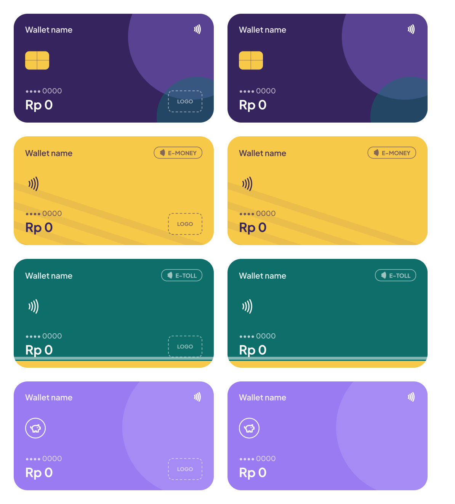
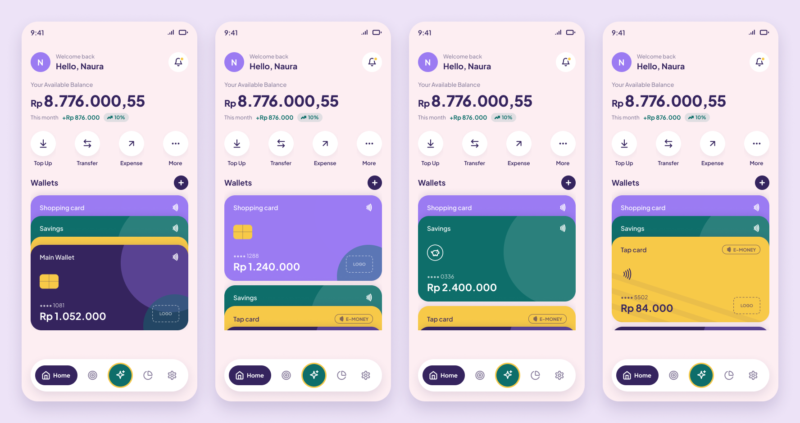
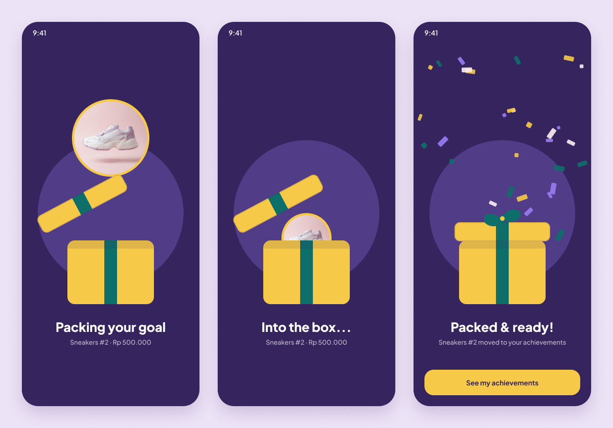

# 4. Bedah Kode

Penjelasan file per file, dari fondasi sampai layar. Total ±6.600 baris Dart di folder `lib/`.

## Daftar isi
- [4.1 Peta file](#41-peta-file)
- [4.2 Fondasi: main, config, theme](#42-fondasi-main-config-theme)
- [4.3 Model data](#43-model-data)
- [4.4 Utilitas format](#44-utilitas-format)
- [4.5 Repo: lapisan data](#45-repo-lapisan-data)
- [4.6 AppState: otak aplikasi](#46-appstate-otak-aplikasi)
- [4.7 Widget umum](#47-widget-umum)
- [4.8 Kartu wallet & tumpukan kartu](#48-kartu-wallet--tumpukan-kartu)
- [4.9 Grafik dengan CustomPainter](#49-grafik-dengan-custompainter)
- [4.10 Layar-layar penting](#410-layar-layar-penting)
- [4.11 Animasi Pack it](#411-animasi-pack-it)
- [4.12 Testing](#412-testing)
- [4.13 Fitur Dart 3 yang dipakai](#413-fitur-dart-3-yang-dipakai)

---

## 4.1 Peta file

| File | Baris | Isi singkat |
| --- | ---: | --- |
| `main.dart` | 29 | Inisialisasi Supabase, `MaterialApp` |
| `config.dart` | 20 | URL & key Supabase |
| `theme.dart` | 61 | `AppColors`, `ts()`, `buildTheme()` |
| `models.dart` | 202 | `Profile`, `Wallet`, `Txn`, `Goal`, `ChatMsg` + enum |
| `categories.dart` | 43 | Kategori pengeluaran & sumber pemasukan |
| `utils/format.dart` | 71 | Format Rupiah & tanggal |
| `data/repo.dart` | 141 | Semua query Supabase |
| `state/app_state.dart` | 348 | Data di memori + perhitungan + mutasi |
| `chatbot/chatbot.dart` | 237 | Parser chatbot |
| `ui/widgets.dart` | 682 | ±15 widget yang dipakai ulang |
| `ui/wallet_card.dart` | 195 | Template kartu wallet |
| `ui/painters.dart` | 76 | Donut chart & confetti |
| `screens/*.dart` | ±4.300 | 21 layar |

## 4.2 Fondasi: main, config, theme

### `main.dart`
```dart
Future<void> main() async {
  WidgetsFlutterBinding.ensureInitialized();          // wajib sebelum memakai plugin
  await Supabase.initialize(
    url: AppConfig.supabaseUrl,
    anonKey: AppConfig.supabaseAnonKey,
  );
  runApp(const DollaanApp());
}
```
`SplashScreen` adalah layar pertama; dialah yang memutuskan ke onboarding, login, setup, atau Home (lihat [alur saat aplikasi dibuka](02-architecture.md#24-alur-saat-aplikasi-dibuka)).

### `config.dart`
```dart
static const supabaseUrl = String.fromEnvironment(
  'SUPABASE_URL',
  defaultValue: 'https://YOUR-PROJECT-ID.supabase.co',
);
```
`String.fromEnvironment` membaca nilai dari `--dart-define` saat build. Dengan begitu key tidak perlu ditulis di kode yang di-commit. Kalau tidak dikirim, dipakai `defaultValue`.

### `theme.dart`
- `AppColors` → konstanta warna dari [sistem desain](01-design-process.md#14-sistem-desain).
- `cardColors` → peta nama warna → `Color` untuk kartu wallet (nama ini yang disimpan di kolom `wallets.color`).
- `ts(size, weight, color)` → helper singkat `GoogleFonts.plusJakartaSans(...)` agar kode layar tidak bertele-tele.
- Extension `o(opacity)` pada `Color` → pembungkus `withValues(alpha: …)` (API baru Flutter pengganti `withOpacity`).

## 4.3 Model data

Setiap tabel punya kelas Dart dengan `fromMap` untuk mengubah baris JSON dari Supabase menjadi objek:

```dart
enum TxnKind { topup, expense, transfer, goal }

class Txn {
  final String id, walletId;
  final TxnKind kind;
  final double amount;
  final String? category, note, toWalletId, goalId;
  final DateTime occurredAt;

  factory Txn.fromMap(Map<String, dynamic> m) => Txn(
        id: m['id'] as String,
        walletId: m['wallet_id'] as String,
        kind: TxnKind.values.byName(m['kind'] as String),
        amount: _num(m['amount']),          // (v as num).toDouble()
        occurredAt: _date(m['occurred_at']), // DateTime.parse(v).toLocal()
        ...
      );
}
```

Hal kecil yang penting:
- **`(x as num).toDouble()`** — kolom `numeric` bisa dikirim sebagai `int` (misal `25000`) atau `double`. Cast langsung ke `double` akan error.
- **`.toLocal()`** — database menyimpan waktu dalam UTC; tampilan harus dalam waktu lokal (WIB).
- **`TxnKind.values.byName(...)`** — nama enum Dart dibuat sama persis dengan nilai di kolom `kind`, jadi konversi dua arah cukup `byName` dan `.name`.

`categories.dart` menyimpan kategori sebagai data statis (`MoneyCategory` dengan nama, ikon, warna). Nama kelasnya `MoneyCategory`, bukan `Category`, karena `Category` sudah dipakai Flutter (anotasi di `foundation.dart`) dan menimbulkan bentrok nama.

## 4.4 Utilitas format

```dart
rupiah(1052000)                 // "Rp 1.052.000"
rupiah(8776000.55, decimals: true) // "Rp 8.776.000,55"
rupiah(250000, sign: true)      // "+Rp 250.000"
compactRp(1500000)              // "1,5 jt"  (untuk label grafik)
parseAmountInput('Rp 25.000')   // 25000
friendlyTime(...)               // "Today · 12:30", "Yesterday · 08:10", "3 Nov 2026"
```
Format Rupiah ditulis manual (tanpa package `intl`) agar hasilnya pasti memakai titik sebagai pemisah ribuan dan koma untuk desimal.

## 4.5 Repo: lapisan data

`Repo` adalah satu-satunya kelas yang mengimpor `supabase_flutter` untuk data. Pola setiap method sama:

```dart
Future<Txn> insertTxn(Map<String, dynamic> data) async {
  final row = await _db.from('transactions').insert(data).select().single();
  return Txn.fromMap(row);
}
```
`.select().single()` setelah `insert` meminta database mengembalikan baris yang baru dibuat (termasuk `id` dan `created_at` buatan database).

Unggah gambar:
```dart
Future<String> uploadImage(Uint8List bytes, String folder, String ext) async {
  final path = '$uid/$folder/${DateTime.now().millisecondsSinceEpoch}.$ext';
  await _db.storage.from(AppConfig.storageBucket).uploadBinary(path, bytes /* + contentType */);
  return _db.storage.from(AppConfig.storageBucket).getPublicUrl(path);
}
```
Memakai `Uint8List` (bukan `File`) supaya kode yang sama berjalan di Android **dan** web (di web tidak ada `dart:io`).

## 4.6 AppState: otak aplikasi

[`lib/state/app_state.dart`](../lib/state/app_state.dart) dibagi menjadi empat bagian.

**1. Memuat data** — lima query dijalankan paralel:
```dart
final results = await Future.wait<Object?>([
  repo.profile(), repo.wallets(), repo.transactions(), repo.goals(), repo.chat(),
]);
```

**2. Saldo** — lihat rumus di [3.6](03-database.md#36-bagaimana-saldo-dihitung):
```dart
double balanceOf(String walletId) {
  var b = walletById(walletId)?.initialBalance ?? 0;
  for (final t in txns) {
    if (t.walletId == walletId) {
      b += t.kind == TxnKind.topup ? t.amount : -t.amount;
    }
    if (t.kind == TxnKind.transfer && t.toWalletId == walletId) b += t.amount;
  }
  return b;
}
```

**3. Statistik & gamifikasi**
- `expenseByCategory(start, end)` → total per kategori, diurutkan dari terbesar (dipakai donut, Top Spending, ringkasan chatbot).
- `monthGrowthPct` → persentase perubahan *net* bulan ini dibanding bulan lalu (badge "10%" di Home).
- `savingByDay()` → `Map<tanggal, jumlah>` setoran goal per hari (dipakai heatmap).
- `streakDays` → hitung mundur dari hari ini selama setiap hari ada setoran:

```dart
int get streakDays {
  final days = savingByDay().keys.toSet();
  var day = dayOnly(DateTime.now());
  if (!days.contains(day)) day = day.subtract(const Duration(days: 1)); // belum nabung hari ini ≠ streak putus
  var count = 0;
  while (days.contains(day)) { count++; day = day.subtract(const Duration(days: 1)); }
  return count;
}
```

**4. Mutasi** — `addWallet`, `setMainWallet`, `addTxn`, `deleteTxn`, `createGoal`, `depositToGoal`, `packGoal`, `deleteGoal`, `addChat`. Polanya: simpan ke Supabase → perbarui list di memori → `notifyListeners()`.

`depositToGoal` sekaligus mengecek apakah target tercapai:
```dart
Future<bool> depositToGoal(Goal goal, String walletId, double amount) async {
  await addTxn(walletId: walletId, kind: TxnKind.goal, amount: amount, goalId: goal.id, ...);
  if (goal.isActive && goalSaved(goal.id) >= goal.target) {
    await _replaceGoal(await repo.updateGoal(goal.id, {'status': 'reached'}));
    return true;   // layar memakai ini untuk membuka "Goal reached!"
  }
  return false;
}
```

## 4.7 Widget umum

`lib/ui/widgets.dart` berisi komponen yang muncul di banyak layar, mirip komponen di Figma:

| Widget | Dipakai untuk |
| --- | --- |
| `CircleBtn` | Tombol ikon bulat putih (back, lonceng dengan titik notifikasi, ⋮) |
| `TopBar` | Judul layar + tombol kiri/kanan |
| `PrimaryButton` | Tombol kuning besar (CTA) |
| `AppCard` | Kotak putih bersudut 24 |
| `AppTextField`, `AmountInput` | Input teks dan input nominal "Rp" besar |
| `ChoiceChipX` | Chip kategori/sumber yang bisa dipilih |
| `ProgressBar` | Progress goal |
| `TxnTile` | Satu baris transaksi (ikon kategori, judul, waktu, nominal +/−) |
| `BalanceText` | Saldo besar dengan "Rp" kecil dan desimal pudar |
| `GoalImage` | Foto goal dari URL, dengan placeholder ikon |
| `WalletSelector` + `pickWallet()` | Pemilih wallet dalam bottom sheet |

Contoh `BalanceText` — menerjemahkan catatan sketsa "low opacity" pada desimal:
```dart
final full = rupiah(value.abs(), decimals: true); // "Rp 8.776.000,55"
final comma = full.lastIndexOf(',');
Text.rich(TextSpan(children: [
  TextSpan(text: 'Rp ', style: ts(size * 0.58, FontWeight.w800, color)),        // "Rp" lebih kecil
  TextSpan(text: full.substring(3, comma), style: ts(size, FontWeight.w800, color)), // "8.776.000"
  TextSpan(text: full.substring(comma), style: ts(size, FontWeight.w800, color.o(0.3))), // ",55" pudar
]));
```

## 4.8 Kartu wallet & tumpukan kartu

### `WalletCardView` (ui/wallet_card.dart)
Satu widget dengan `switch` pada `WalletType` untuk menggambar 4 template: lingkaran dekoratif, chip emas, ikon kontaktless, badge E-MONEY/E-TOLL, garis strip, ikon celengan. Logo pengguna (jika ada) ditaruh di pojok kanan bawah dengan `Image.network`.



### `WalletStack` (screens/home_screen.dart)
Tumpukan kartu dibuat dengan `Stack` + `AnimatedPositioned`. Setiap kartu hanya dihitung posisi `top`-nya; Flutter menganimasikan perpindahannya.

```dart
double topOf(int i) {
  if (sel < 0) {                                       // tidak ada kartu yang dibuka
    if (i < n - 1) return i * _peek;                   // kartu belakang: mengintip 46 px
    return n == 1 ? 0 : max(_peek, (n - 1) * _peek - 28); // kartu utama (paling depan)
  }
  if (i <= sel) return i * _peek;                      // kartu sebelum yang dipilih
  return sel * _peek + _cardH + 10 + (i - sel - 1) * _peek; // kartu setelahnya turun
}
```
- Kartu utama diurutkan paling akhir sehingga digambar paling atas (`Stack` menggambar anak terakhir paling depan).
- `key: ValueKey(wallet.id)` penting agar Flutter tahu kartu mana yang berpindah, bukan menggambar ulang dari nol.
- Tap kartu belakang → `_selectedId` diisi → semua `top` dihitung ulang → kartu terbuka dengan animasi 450 ms.



> 🐞 Rumus `(n - 1) * _peek - 28` membuat kartu utama menutupi 28 px kartu tepat di belakangnya, sehingga nama kartu itu tidak terlihat. Lihat [bug v1.0](07-challenges-and-lessons.md#bug-yang-ditemukan-di-v10).

## 4.9 Grafik dengan CustomPainter

Tidak memakai package chart; donut digambar sendiri agar persis seperti desain.

```dart
class Slice { final double value; final Color color; const Slice(this.value, this.color); }

class DonutPainter extends CustomPainter {
  final List<Slice> slices;
  @override
  void paint(Canvas canvas, Size size) {
    final stroke = size.width * 0.15;                       // tebal cincin 15% dari lebar
    final rect = Rect.fromLTWH(stroke / 2, stroke / 2, size.width - stroke, size.height - stroke);
    final total = slices.fold<double>(0, (s, e) => s + e.value);
    final paint = Paint()..style = PaintingStyle.stroke..strokeWidth = stroke;
    final gap = slices.length > 1 ? 0.05 : 0.0;             // celah kecil antar potongan
    var start = -pi / 2;                                    // mulai dari jam 12
    for (final s in slices) {
      final sweep = s.value / total * 2 * pi;
      paint.color = s.color;
      canvas.drawArc(rect, start + gap / 2, max(0.0, sweep - gap), false, paint);
      start += sweep;
    }
  }
}
```
`ConfettiPainter` menggambar potongan kertas berwarna yang posisinya bergantung pada nilai animasi 0→1 (dipakai di *Goal reached* dan *Pack it*).

Diagram batang *Top Spending* cukup dibuat dari `Container` dengan tinggi proporsional terhadap kategori terbesar.

## 4.10 Layar-layar penting

| Layar | Hal yang menarik untuk dipelajari |
| --- | --- |
| `splash_screen.dart` | Routing awal berdasarkan `shared_preferences`, sesi Supabase, dan `profile.setupDone` |
| `onboarding_screen.dart` | `PageView` + indikator titik + tombol Next/Skip |
| `auth_screen.dart` | Satu layar untuk Login/Daftar; menampilkan pesan error Supabase dengan ramah |
| `setup_screen.dart` | Wizard 3 langkah dalam satu `PageView` yang di-*lock* (`NeverScrollableScrollPhysics`) |
| `shell.dart` | Bottom nav mengambang + `IndexedStack`, tombol tengah membuka chat |
| `home_screen.dart` | `BalanceText`, aksi cepat, `WalletStack`, tekan-lama kartu |
| `transaction_screen.dart` | Satu layar untuk **Top Up** dan **Expense** (parameter `TxnKind`) — mengurangi duplikasi |
| `transfer_screen.dart` | Validasi wallet asal ≠ tujuan, pratinjau saldo setelah transfer |
| `statistic_screen.dart` | Filter periode, donut ↔ bar, `Dismissible` untuk hapus transaksi dengan geser |
| `goals_screen.dart` | `StreakChip`, kartu goal aktif, total tabungan |
| `goal_detail_screen.dart` | `SavingHeatmap` (grid 7 hari × 17 minggu, hari ini kuning), sheet *Add money* |
| `chat_screen.dart` | Gelembung chat, kartu konfirmasi, slot filling — lihat [5. Chatbot](05-chatbot.md) |
| `notifications_screen.dart` | Notifikasi **dihitung** dari data (`buildNotifications()`), bukan disimpan |

## 4.11 Animasi Pack it

Satu `AnimationController` 2,6 detik dibagi menjadi beberapa fase dengan `Interval`:

```dart
_c = AnimationController(vsync: this, duration: const Duration(milliseconds: 2600));
_drop  = CurvedAnimation(parent: _c, curve: const Interval(0.10, 0.45, curve: Curves.easeInCubic)); // barang jatuh ke kotak
_lid   = CurvedAnimation(parent: _c, curve: const Interval(0.50, 0.75, curve: Curves.easeOutBack)); // tutup kotak
_party = CurvedAnimation(parent: _c, curve: const Interval(0.75, 1.00, curve: Curves.easeOut));    // pita + confetti
```



```mermaid
gantt
    dateFormat X
    axisFormat %L ms
    section Pack it
    Barang jatuh      :0260, 1170
    Tutup kotak       :1300, 1950
    Pita & confetti   :1950, 2600
```

Teknik ini (satu controller, banyak `Interval`) adalah cara paling sederhana membuat animasi bertahap yang tetap sinkron. Ini padanan *Smart Animate* antar 3 frame di prototype Figma.



## 4.12 Testing

```
test/
├─ chatbot_test.dart   # parser: nominal, intent, kategori, wallet, transfer terbalik, slot kosong
└─ widget_test.dart    # format Rupiah & compactRp
```
Jalankan dengan `flutter test`. Chatbot dibuat tanpa ketergantungan Flutter justru supaya bisa dites seperti ini. Contoh:

```dart
test('transfer urutan terbalik', () {
  final c = ChatParser.parse('transfer 50rb ke savings dari tap card', wallets);
  expect(c.wallet?.id, '3');    // Tap card
  expect(c.toWallet?.id, '2');  // Savings
});
```

## 4.13 Fitur Dart 3 yang dipakai

| Fitur | Contoh di project |
| --- | --- |
| **Records** | `List<(Wallet, int)>` di `findWallets`, dibaca dengan `.$1` / `.$2` |
| **Switch expression** | `final kind = switch (cmd.intent) { BotIntent.income => TxnKind.topup, ... };` |
| **Switch tanpa `break`** | Case tidak lagi "jatuh" ke case berikutnya bila punya isi |
| **Enum `.name` / `.byName`** | Konversi enum ↔ string database |

Lanjut ke **[5. Chatbot →](05-chatbot.md)**
