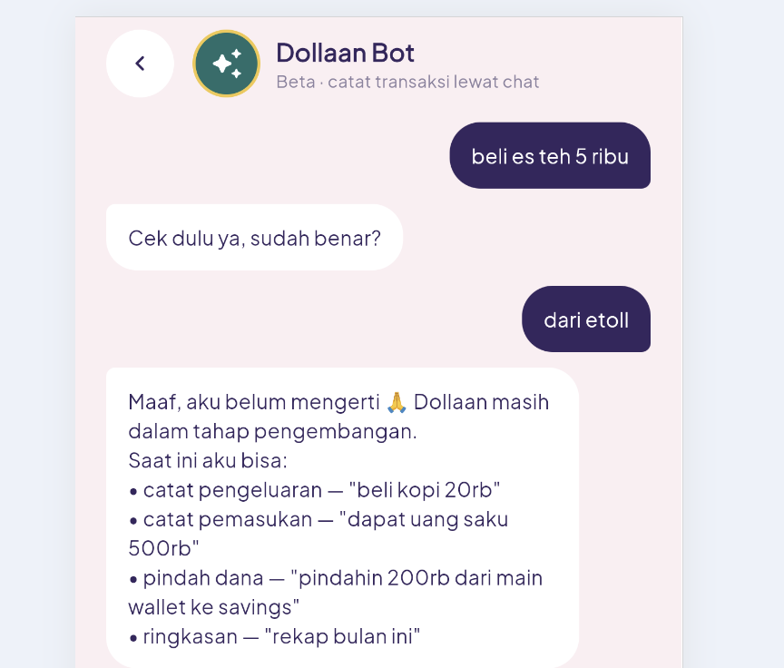
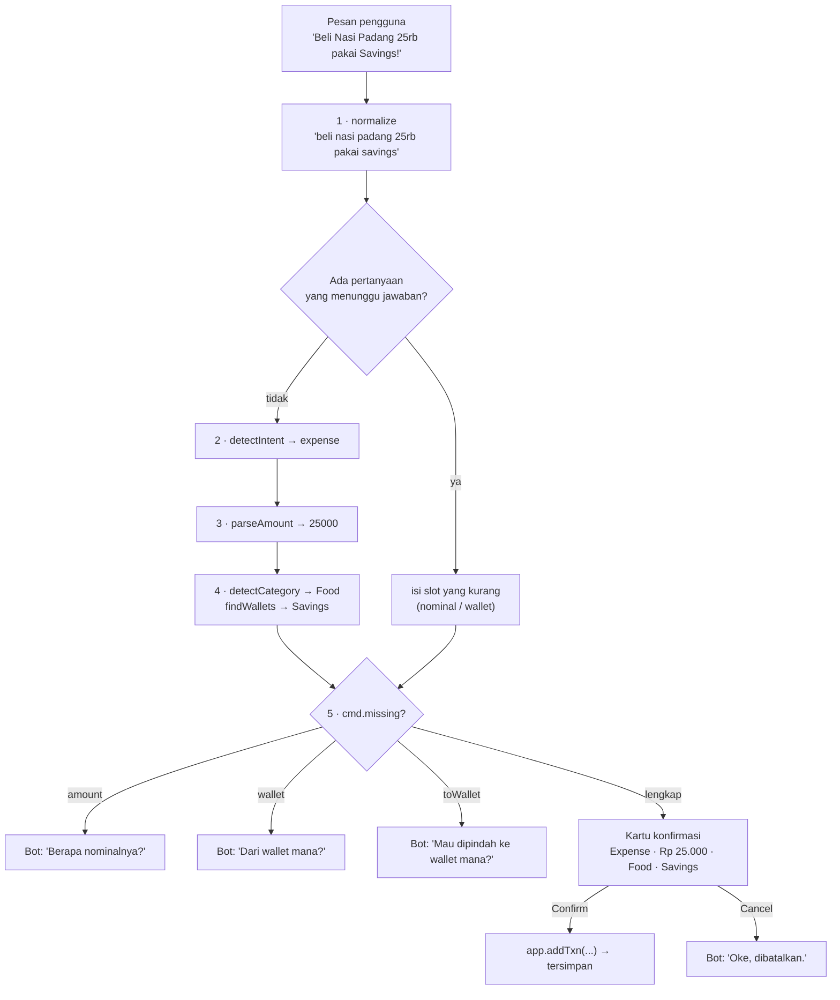

# 5. Chatbot Rule-Based

Dollaan Bot memungkinkan pengguna mencatat transaksi dengan kalimat sehari-hari, misalnya `beli nasi padang 25rb`. Bot ini **tidak memakai AI/LLM**. Ia memakai aturan sederhana (kata kunci + regex) yang berjalan di perangkat. Dokumen ini menjelaskan alasan, cara kerja, dan batasannya, sehingga bisa dipakai sebagai bahan belajar membuat chatbot pertama.



## Daftar isi
- [5.1 Kenapa rule-based, bukan Claude API?](#51-kenapa-rule-based-bukan-claude-api)
- [5.2 Kemampuan bot](#52-kemampuan-bot)
- [5.3 Pipeline](#53-pipeline)
- [5.4 Langkah 1 — Normalisasi](#54-langkah-1--normalisasi)
- [5.5 Langkah 2 — Deteksi intent](#55-langkah-2--deteksi-intent)
- [5.6 Langkah 3 — Ekstraksi nominal (regex)](#56-langkah-3--ekstraksi-nominal-regex)
- [5.7 Langkah 4 — Kategori & wallet](#57-langkah-4--kategori--wallet)
- [5.8 Langkah 5 — Slot filling & konfirmasi](#58-langkah-5--slot-filling--konfirmasi)
- [5.9 Ringkasan bulanan](#59-ringkasan-bulanan)
- [5.10 Batasan & cara mengembangkan](#510-batasan--cara-mengembangkan)

---

## 5.1 Kenapa rule-based, bukan Claude API?

Rencana awal memakai Claude API. Setelah dihitung ulang:

| Pertimbangan | Claude API | Rule-based |
| --- | --- | --- |
| Biaya | Dibayar per token, terpisah dari langganan Claude Pro | Gratis |
| Keamanan key | API key **tidak boleh** ada di APK → butuh server/Edge Function perantara | Tidak ada key |
| Kebutuhan fitur | Bisa apa saja | 4 perintah sudah cukup untuk v1.0 |
| Bisa dites | Jawaban tidak selalu sama | Deterministik, mudah di-unit-test |
| Offline | Tidak | Parsing jalan offline (menyimpan tetap butuh internet) |

Keputusannya: v1.0 memakai bot rule-based dengan cakupan **sengaja dibatasi**. Di luar cakupan, bot jujur bilang belum mengerti. Kolom `understood` di database mencatat kalimat yang gagal sebagai bahan perbaikan.

## 5.2 Kemampuan bot

| Intent | Contoh kalimat | Hasil |
| --- | --- | --- |
| `expense` | `beli kopi 20rb`, `bayar wifi 350rb pakai savings`, `kopi 20rb` | Transaksi pengeluaran |
| `income` | `gajian 3jt`, `dapat uang saku 500rb ke savings`, `nemu 10rb` | Transaksi pemasukan |
| `transfer` | `pindahin 200rb dari main wallet ke savings`, `tf 50rb ke tap card` | Transfer antar wallet |
| `summary` | `rekap bulan ini`, `ringkasan bulan lalu` | Teks ringkasan |
| `help` | `halo`, `bisa apa` | Daftar contoh perintah |
| `unknown` | `rekomendasi saham dong` | Pesan "belum mengerti" |

Kata `kemarin` di kalimat membuat tanggal transaksi = kemarin.

## 5.3 Pipeline



Pembagian file:
- **`lib/chatbot/chatbot.dart`** — langkah 1–4, murni Dart, tanpa Flutter → bisa di-unit-test.
- **`lib/screens/chat_screen.dart`** — langkah 5 (percakapan, kartu konfirmasi, menyimpan), serta ringkasan.

## 5.4 Langkah 1 — Normalisasi

```dart
static String normalize(String text) => text
    .toLowerCase()
    .replaceAll(RegExp(r'[!?;"]'), ' ')
    .replaceAll(RegExp(r'\s+'), ' ')
    .trim();
```
Semua huruf kecil, tanda baca tertentu dibuang, spasi ganda dirapikan. Titik dan koma **tidak** dibuang karena dibutuhkan untuk nominal (`25.000`, `1,5jt`).

## 5.5 Langkah 2 — Deteksi intent

Setiap intent punya daftar kata kunci. Pengecekan dilakukan **berurutan**, dan urutan inilah yang menyelesaikan ambiguitas:

```dart
if (_hasAny(t, _summaryWords))  return BotIntent.summary;   // 'rekap', 'ringkasan', 'habis berapa', ...
if (_hasAny(t, _transferWords)) return BotIntent.transfer;  // 'pindah', 'pindahin', 'tf ', 'kirim ke', ...
if (_hasAny(t, _incomeWords))   return BotIntent.income;    // 'gajian', 'dapat', 'uang saku', 'nemu', ...
if (_hasAny(t, _expenseWords))  return BotIntent.expense;   // 'beli', 'bayar', 'jajan', 'makan', ...
if (sapaan)                     return BotIntent.help;
if (parseAmount(t) != null)     return BotIntent.expense;   // "kopi 20rb" tanpa kata kerja
return BotIntent.unknown;
```

Kenapa urutannya begitu?
- `habis berapa bulan ini` mengandung `habis` (kata pengeluaran), tapi maksudnya meminta ringkasan → **summary dicek lebih dulu**.
- `transfer` dicek sebelum `income` agar `pindahin 200rb ke savings` tidak dianggap uang masuk ke Savings.
- Kalimat yang hanya berisi barang + nominal paling sering adalah pengeluaran, jadi itu *default*-nya.

Perhatikan kata kunci dengan spasi seperti `'tf '` dan `'jual '`: spasi mencegah kecocokan di tengah kata lain (`'tf'` akan cocok dengan "gift", misalnya).

## 5.6 Langkah 3 — Ekstraksi nominal (regex)

```dart
static final _amountRe =
    RegExp(r'(?:rp\.?\s*)?(\d+(?:[.,]\d+)*)\s*(rb|ribu|k|jt|juta)?(?![a-z])');
```

Membaca regex ini bagian per bagian:

| Bagian | Arti | Cocok dengan |
| --- | --- | --- |
| `(?:rp\.?\s*)?` | Awalan "rp" / "rp." opsional, tidak ditangkap | `rp 25.000`, `rp.25000` |
| `(\d+(?:[.,]\d+)*)` | **Grup 1**: angka, boleh dipisah titik/koma | `25`, `25.000`, `1,5`, `1.250.000` |
| `\s*` | Spasi opsional | `25 rb` |
| `(rb\|ribu\|k\|jt\|juta)?` | **Grup 2**: satuan opsional | `rb`, `jt` |
| `(?![a-z])` | *Negative lookahead*: tidak boleh langsung diikuti huruf | menolak `5kg`, `2kali` |

Lalu diterjemahkan:
```dart
if (unit == 'jt' || unit == 'juta')       value = double.parse(raw.replaceAll(',', '.')) * 1000000; // "1,5" → 1.5
else if (unit == 'rb' || ... || unit == 'k') value = double.parse(raw.replaceAll(',', '.')) * 1000;
else                                        value = double.parse(raw.replaceAll(RegExp(r'[.,]'), '')); // "25.000" → 25000
if (value >= 100) return value;   // abaikan angka kecil
```

Aturan `>= 100` mencegah `sneakers #2` atau `beli 3 donat` membaca 2 atau 3 sebagai nominal. Konsekuensinya: tanpa satuan, koma/titik dianggap pemisah ribuan (`Rp 25.000` → 25000), tetapi dengan satuan dianggap desimal (`1,5jt` → 1.500.000). Ini sesuai kebiasaan menulis orang Indonesia.

## 5.7 Langkah 4 — Kategori & wallet

**Kategori**: kamus kata kunci per kategori; kategori pertama yang cocok menang, kalau tidak ada → `Other`.

```dart
'Food':      ['makan', 'nasi', 'kopi', 'bakso', 'padang', 'boba', ...],
'Transport': ['gojek', 'grab', 'bensin', 'krl', 'parkir', ...],
'Bills':     ['listrik', 'wifi', 'pulsa', 'token', 'kos ', ...],
```
Untuk pemasukan ada kamus sendiri, termasuk sumber jenaka dari sketsa: `nemu` → *Found on street*, `bonus`/`thr`/`hoki` → *Falling from heaven*.

**Wallet**: nama setiap wallet milik pengguna dicari di kalimat (atau 4 digit terakhirnya), dan hasilnya diurutkan berdasarkan posisi kemunculan:

```dart
static List<(Wallet, int)> findWallets(String text, List<Wallet> wallets) {
  for (final w in wallets) {
    var idx = t.indexOf(w.name.toLowerCase());
    if (idx < 0 && w.last4.isNotEmpty) idx = t.indexOf(w.last4);
    if (idx >= 0) found.add((w, idx));
  }
  found.sort((a, b) => a.$2.compareTo(b.$2));   // urut sesuai posisi di kalimat
}
```

Aturan untuk transfer:

| Wallet yang disebut | Asal | Tujuan |
| --- | --- | --- |
| Dua: `dari A ke B` | A (yang disebut pertama) | B |
| Dua, terbalik: `ke B dari A` | A (dibalik karena posisi "ke" < "dari") | B |
| Satu, dengan "ke": `ke B` | Wallet utama | B |
| Satu, tanpa "ke" | Wallet itu | *(ditanyakan)* |
| Tidak ada | Wallet utama | *(ditanyakan)* |

Untuk expense/income, wallet yang tidak disebut otomatis memakai **wallet utama**.

## 5.8 Langkah 5 — Slot filling & konfirmasi

Sebuah perintah dianggap lengkap jika "slot"-nya terisi. `ParsedCommand.missing` memberi tahu slot mana yang masih kosong:

```dart
String? get missing {
  if (amount == null) return 'amount';
  if (wallet == null) return 'wallet';
  if (intent == BotIntent.transfer && toWallet == null) return 'toWallet';
  return null;
}
```

Jika ada yang kurang, layar chat menyimpan perintah setengah jadi di `_pending` dan bertanya. Pesan berikutnya dicoba dulu sebagai **jawaban** atas pertanyaan itu:

```
Kamu : beli kopi
Bot  : Berapa nominalnya? (contoh: 25rb)
Kamu : 18rb                      ← _fillPending: parseAmount("18rb") = 18000
Bot  : Cek dulu ya, sudah benar?  [Expense · Rp 18.000 · Food · Main Wallet]  [Cancel] [Confirm]
```

Kalau pesan berikutnya bukan jawaban yang valid (misalnya bukan angka), `_pending` dibuang dan pesan diproses sebagai perintah baru.

Kenapa harus ada **kartu konfirmasi**? Parser berbasis aturan pasti kadang salah tebak (kategori, wallet). Konfirmasi membuat kesalahan itu terlihat sebelum data tersimpan, dan membuat pengguna tetap memegang kendali.

Setelah *Confirm*, intent dipetakan ke jenis transaksi dengan *switch expression*:
```dart
final kind = switch (cmd.intent) {
  BotIntent.income   => TxnKind.topup,
  BotIntent.transfer => TxnKind.transfer,
  _                  => TxnKind.expense,
};
```

## 5.9 Ringkasan bulanan

`rekap bulan ini` tidak membuat transaksi; bot menghitung dari `AppState`:

```
Ringkasan November 2026:
• Pemasukan: Rp 4.200.000
• Pengeluaran: Rp 1.150.000
• Ditabung ke goal: Rp 300.000
• Sisa: Rp 2.750.000
Pengeluaran terbesar: Food (Rp 368.000, 32%).
Pengeluaranmu turun 12% dibanding bulan sebelumnya. Mantap! 🎉
```
Menu ⋮ → *Summarize* di layar Statistic membuka chat dan langsung mengirim perintah ini.

## 5.10 Batasan & cara mengembangkan

Batasan v1.0 (beberapa ditemukan saat uji coba, lihat [bug v1.0](07-challenges-and-lessons.md#bug-yang-ditemukan-di-v10)):

1. **Nama wallet harus disebut persis.** Wallet bernama "BCA Debit" tidak terdeteksi dari kata "bca" saja, apalagi dari tipe ("etoll", "e-money", "bank").
2. **Draf tidak bisa dikoreksi.** Setelah kartu konfirmasi muncul, pesan seperti `dari etoll` tidak dihubungkan ke draf (lihat gambar di atas). Selain itu `_pending` adalah variabel `State`; keluar dari layar chat → pertanyaan yang belum dijawab hilang.
3. **Satu transaksi per pesan.** `beli kopi 20rb dan roti 15rb` hanya membaca nominal pertama.
4. **Kata kunci bisa tumpang tindih.** `jalan` (Found on street) bisa muncul di kalimat lain.
5. **Bahasa campur & typo** belum ditangani.

Ide pengembangan, dari yang paling sederhana:

- **Pencocokan wallet lebih longgar**: cocokkan per kata ("bca"), alias buatan pengguna, atau tipe wallet (`emoney`, `etoll`, `bank`) bila hanya ada satu wallet bertipe itu.
- **Simpan draf di `AppState`** agar bertahan saat berpindah layar, dan izinkan koreksi ("bukan, pakai savings").
- **Fuzzy matching** (jarak Levenshtein) untuk typo.
- **Belajar dari data**: kelompokkan pesan `understood = false` untuk menambah kata kunci.
- **Model kecil on-device** (misalnya klasifikasi intent dengan TensorFlow Lite) bila aturan sudah terlalu banyak.
- **LLM dengan *function calling*** lewat Supabase Edge Function (API key aman di server), dengan parser rule-based tetap jadi jalur cepat dan cadangan.

Lanjut ke **[6. Panduan setup →](06-setup-guide.md)**
