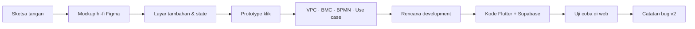
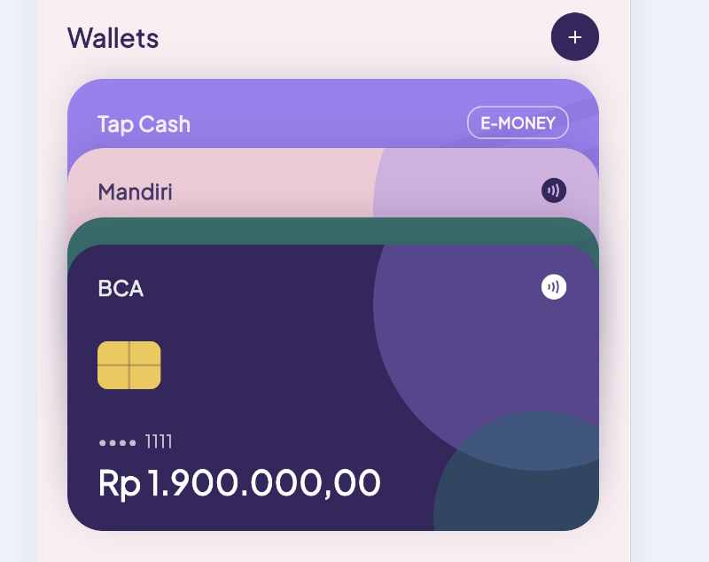
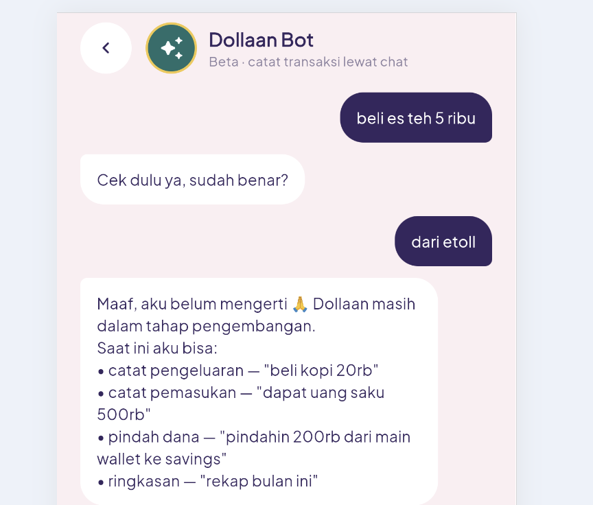

# 7. Kendala & Pelajaran

Catatan jujur tentang apa yang tidak berjalan mulus selama membangun Dollaan v1.0, bagaimana diatasi, dan apa yang dipelajari. Bagian ini mungkin yang paling berguna untuk siapa pun yang akan membangun aplikasi pertamanya.

## Daftar isi
- [7.1 Timeline singkat](#71-timeline-singkat)
- [7.2 Kendala desain (Figma)](#72-kendala-desain-figma)
- [7.3 Kendala kode (Flutter/Dart)](#73-kendala-kode-flutterdart)
- [7.4 Kendala environment & backend](#74-kendala-environment--backend)
- [7.5 Keputusan produk yang sulit](#75-keputusan-produk-yang-sulit)
- [Bug yang ditemukan di v1.0](#bug-yang-ditemukan-di-v10)
- [7.6 Rencana v2](#76-rencana-v2)
- [7.7 Pelajaran utama](#77-pelajaran-utama)

---

## 7.1 Timeline singkat



## 7.2 Kendala desain (Figma)

| Masalah | Penyebab | Solusi / pelajaran |
| --- | --- | --- |
| Transparansi warna hilang setelah warna diikat ke *variable* | Mengikat fill ke color variable mereset opacity paint | Set ulang opacity setelah binding. Pelajaran: cek hasil visual setiap kali memakai variable |
| Opacity elemen di dalam *instance* komponen tidak terbawa | Opacity diletakkan di paint, bukan di layer | Pindahkan ke opacity layer (`node.opacity`) |
| *Auto layout* menyusut setelah di-resize | Sizing mode kembali ke *hug* | Atur sizing mode secara eksplisit (*fixed* / *fill*) |
| Strip dekorasi kartu E-toll menimpa teks saldo | Posisi elemen absolut tidak memperhitungkan teks | Geser strip ke tepi bawah kartu |
| Logo merek di template kartu | Ingin kartu terlihat seperti BCA/Flazz asli | Diganti template generik + slot logo; menghindari reproduksi merek di repo publik |

**Pelajaran:** penamaan layer yang konsisten (`btn:Top Up`, `nav:Goals`) sangat menghemat waktu saat menyambung prototype dan membuat *Smart Animate* bekerja.

## 7.3 Kendala kode (Flutter/Dart)

| Masalah | Penyebab | Solusi |
| --- | --- | --- |
| Error nama bentrok `Category` | Flutter sudah punya `Category` (anotasi di `foundation.dart`) | Ganti nama kelas menjadi `MoneyCategory` |
| Variabel di dalam `case` bentrok antar-case | Di Dart, semua `case` dalam satu `switch` berbagi *scope* | Bungkus isi case dengan `{ }` |
| `type 'int' is not a subtype of type 'double'` | Kolom `numeric` dikirim sebagai `int` jika tidak ada desimal | Selalu `(v as num).toDouble()` |
| Tumpukan kartu tidak ikut berubah setelah tambah wallet | Widget `const WalletStack()` tidak di-*rebuild* | Hapus `const` di tempat yang harus mengikuti `ListenableBuilder` |
| Urutan riwayat chat terbalik setelah dibuka ulang | Balasan bot tersimpan lebih dulu dari pesan pengguna | `await` penyimpanan pesan pengguna sebelum memproses balasan |

**Pelajaran:** menulis bagian logika (chatbot, format Rupiah) sebagai Dart murni yang bisa di-unit-test membuat bug ketahuan sebelum aplikasi dijalankan.

## 7.4 Kendala environment & backend

Ini bagian yang paling banyak memakan waktu — bukan kodenya.

| Masalah | Gejala | Solusi |
| --- | --- | --- |
| **Lupa pernah install Flutter** | Tidak yakin versi/lokasi | `flutter --version` dan `where.exe flutter` |
| **Disk C penuh (0 byte)** | `flutter run -d chrome` gagal terus | Bersihkan C, pindahkan `TEMP`/`TMP` ke drive D. [Detail](06-setup-guide.md#disk-c-penuh--build-gagal) |
| **Ingin menggabung partisi** | Bingung NTFS & Disk Management | Partisi hanya bisa diperluas ke ruang kosong yang bersebelahan; backup dulu |
| **Login 404** | Error saat login | URL Supabase harus alamat dasar `https://<ref>.supabase.co` |
| **Email signups/logins disabled** | `email_provider_disabled` | Aktifkan provider Email lalu tekan **Save** |
| **Letak "Confirm email"** | Tidak ketemu di menu provider | Ada di bagian *User Signups* pada *Sign In / Providers* |
| **Nama key baru Supabase** | Tutorial menyebut "anon key", dashboard menampilkan "publishable key" | Keduanya setara untuk aplikasi klien; *anon* ada di tab *Legacy* |

**Pelajaran:** dokumentasi pihak ketiga (Supabase, Flutter) berubah cepat — nama menu dan key di tutorial bisa sudah berbeda. Membaca pesan error dengan teliti (`404`, `email_provider_disabled`) hampir selalu langsung menunjuk ke penyebabnya.

## 7.5 Keputusan produk yang sulit

- **Claude API → chatbot rule-based.** Biaya API terpisah dari langganan dan key tidak boleh ditaruh di APK. Solusi rule-based ternyata cukup untuk 4 perintah inti dan jauh lebih mudah dites. [Detail](05-chatbot.md#51-kenapa-rule-based-bukan-claude-api)
- **Play Store → APK.** Untuk uji coba pribadi, sideload APK jauh lebih cepat daripada proses review.
- **Tim → solo developer.** Rencana disederhanakan: Supabase menggantikan backend sendiri, `ChangeNotifier` menggantikan state management yang lebih kompleks.
- **Cakupan v1.0 dibatasi.** Fitur seperti PIN, export laporan, budget per kategori, dan push notification ditunda agar v1.0 benar-benar selesai.

## Bug yang ditemukan di v1.0

Ditemukan saat uji coba pertama di browser (`flutter run -d chrome`).

### 🐞 1. Kartu kedua "terpendam", namanya tidak terlihat



**Penyebab:** di `WalletStack`, kartu utama diletakkan di `max(46, (n − 1) × 46 − 28)`. Pengurangan 28 px membuat kartu utama naik dan menutupi area judul kartu tepat di belakangnya (dengan 3 kartu: kartu ke-2 di `top 46`, kartu utama di `top 64` → hanya 18 px yang terlihat).

**Rencana perbaikan:** kartu utama diletakkan di `(n − 1) × 46` agar setiap kartu belakang mendapat 46 px penuh untuk menampilkan namanya.
```dart
return n == 1 ? 0 : (n - 1) * _peek;
```

### 🐞 2. Chatbot "tidak punya memori"



**Yang terjadi:** pengguna menulis `beli es teh 5 ribu`. Karena tidak ada wallet yang disebut, bot memakai wallet utama dan langsung menampilkan kartu konfirmasi. Pengguna lalu mengoreksi `dari etoll` — bot tidak menghubungkannya dengan draf sebelumnya dan membalas "belum mengerti".

**Penyebab:**
- Bot hanya "mengingat" draf ketika ia sendiri sedang **bertanya** (slot kosong). Draf yang sudah lengkap dan menunggu konfirmasi tidak bisa dikoreksi lewat pesan berikutnya.
- `etoll` adalah **tipe** wallet, bukan nama wallet. Pencocokan wallet hanya mencari nama lengkap atau 4 digit terakhir.
- Draf (`_pending`) disimpan di `State` layar chat, sehingga hilang saat keluar dari layar.

**Rencana perbaikan:**
- Pesan pendek setelah kartu konfirmasi (`dari X`, `pakai X`, `bukan, X`) diperlakukan sebagai **koreksi** draf yang sedang terbuka.
- Pencocokan wallet per kata, alias, dan tipe (`etoll`, `e-money`, `bank`) bila tipenya unik.
- Pindahkan draf ke `AppState` agar bertahan saat berpindah layar.

### 🐞 3. Slide onboarding berganti tanpa interaksi

**Gejala:** di browser, slide onboarding pindah sendiri / terlalu cepat.
**Dugaan penyebab:** gestur scroll (touchpad/mouse wheel) di web diteruskan ke `PageView` sehingga terhitung sebagai swipe.
**Rencana perbaikan:** batasi perpindahan hanya lewat tombol *Next*/swipe yang disengaja (misalnya `PageScrollPhysics` khusus atau mematikan scroll mouse di web), lalu uji di perangkat Android sungguhan untuk memastikan.

## 7.6 Rencana v2

| Prioritas | Item |
| --- | --- |
| Tinggi | Perbaiki 3 bug di atas |
| Tinggi | Auto-save goal (sudah ada kolom `auto_save`, belum ada penjadwalnya) |
| Sedang | Edit transaksi & wallet (saat ini hanya tambah/hapus) |
| Sedang | Terjemahan Bahasa Indonesia penuh (preferensi bahasa sudah tersimpan) |
| Sedang | PIN & biometrik, push notification terjadwal |
| Rendah | Mode offline + sinkronisasi, export laporan, budget per kategori, transaksi berulang |

## 7.7 Pelajaran utama

1. **Mulai dari kertas.** Sketsa 2 halaman menjadi acuan untuk puluhan keputusan di Figma dan kode.
2. **Desain dulu, kode kemudian — tapi siap berubah.** Banyak keputusan (Withdraw → Expense, Wallet tab → Goals tab) baru terasa salah setelah dilihat dalam bentuk hi-fi.
3. **Pilih teknologi sesuai skala.** Supabase + `ChangeNotifier` cukup untuk solo developer; arsitektur "besar" bisa menyusul.
4. **Keamanan di database, bukan di aplikasi.** RLS membuat key publik di APK tetap aman.
5. **Simpan fakta, hitung turunannya.** Menyimpan transaksi dan menghitung saldo menghindari data yang tidak konsisten.
6. **Batasi cakupan dengan jujur.** Bot yang bilang "aku belum mengerti" lebih baik daripada bot yang salah tebak diam-diam.
7. **Environment adalah bagian dari pekerjaan.** Disk penuh dan salah URL memakan waktu lebih lama dari menulis fitur; mencatatnya menyelamatkan waktu di project berikutnya.
8. **Uji di perangkat sungguhan.** Beberapa bug (onboarding) mungkin hanya muncul di web.

← Kembali ke **[indeks dokumentasi](README.md)**
